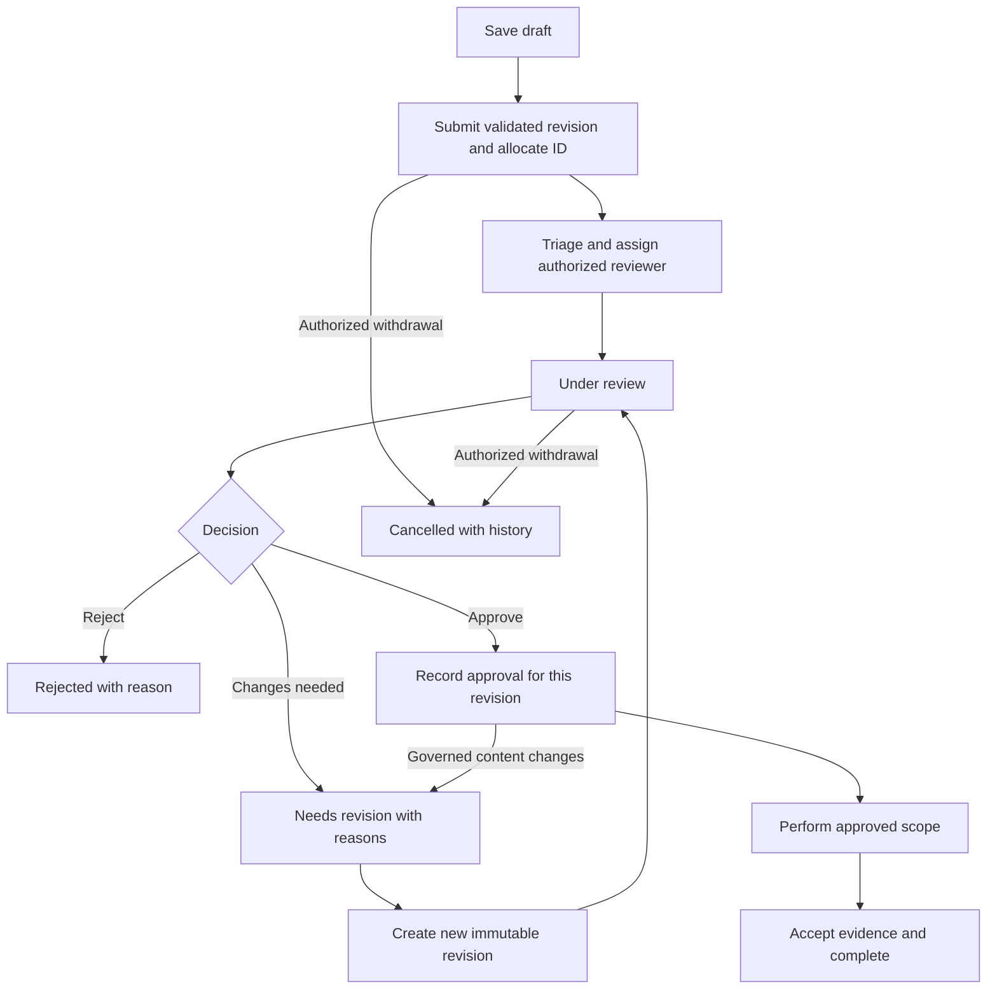
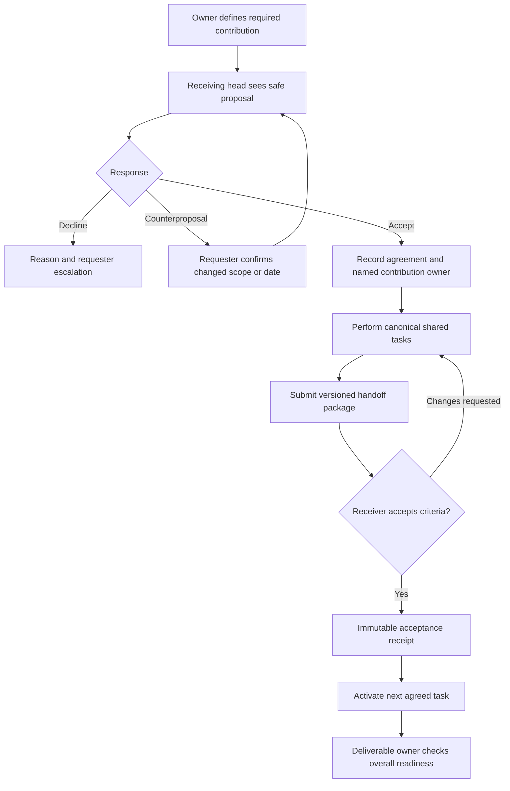
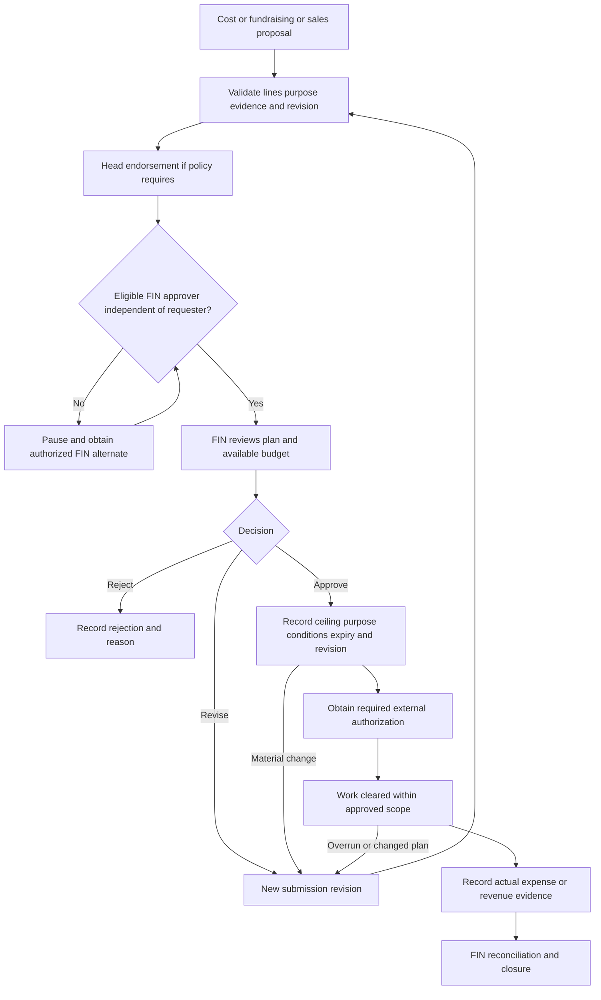
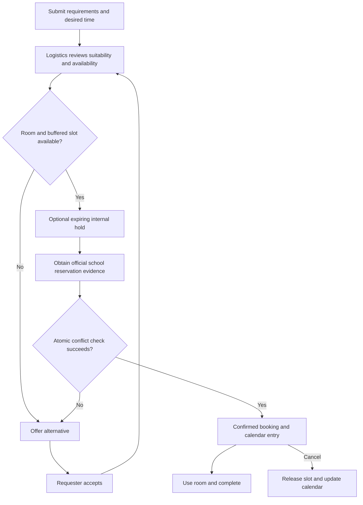
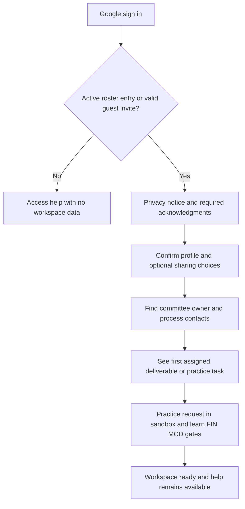
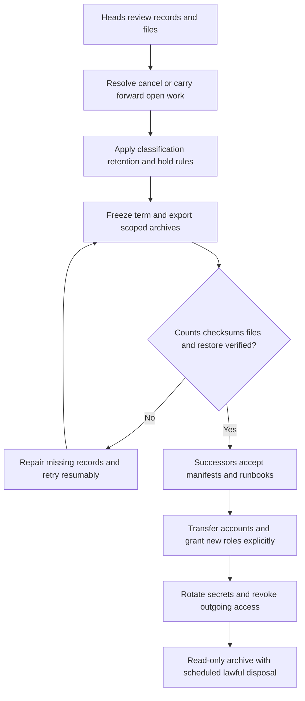
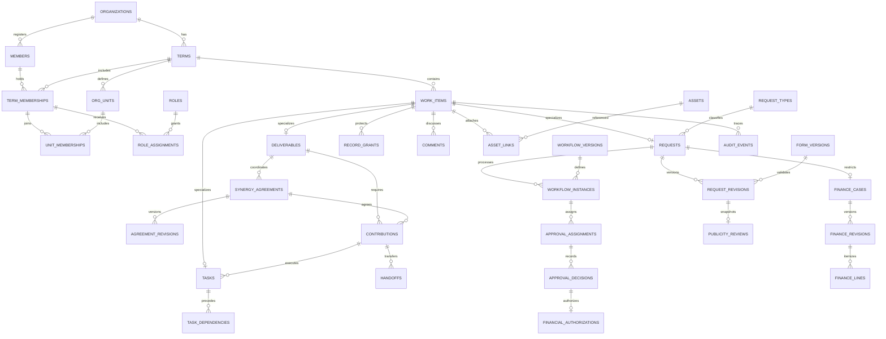

# TEDx Core Dashboard — Implementation Plan

Prepared for TEDxAteneodeManilaU core team, term 2026–2027. Baseline: October 23, 2026. Event: April 17, 2027. All schedules use Asia/Manila. Status: proposed implementation specification, not approved school or department policy. External guidance and product limits checked October 23, 2026.

Reference prototype: [TEDx Core Dashboard demo](https://tedx-core-dashboard-demo.vercel.app). Its static HTML/CSS and sample flows were inspected; this plan does not claim a completed visual or accessibility audit of the demo.

## 1. Executive summary and guiding principles

### Recommendation

Build a private, mobile-friendly application centered on **Core Deliverables**, **Committee Synergies**, and **cross-committee tasks**. Use Supabase for authentication, PostgreSQL, private files, and transactional workflows; use a React/TypeScript frontend on Cloudflare Pages. Integrate Google Drive for collaborative documents, selected files, and controlled exports. Keep Messenger and Telegram for conversation with links back to authoritative records.

Every deliverable has one accountable person, one lead committee, named contributions from supporting committees, a deadline, acceptance criteria, and evidence. Tasks, handoffs, department requests, FIN decisions, and MCD reviews connect to it. The deliverables page answers: What must ship? Who owns it? What is blocked? Who owes the next action?

Your clarified priorities are requirements: FIN reviews costs and fundraising/sales plans; MCD reviews finalized publicity materials; school access uses exactly `student.ateneo.edu`; invited guests may use other domains; sensitive records live inside the application with Google Drive integration. Actual payments, a public website, and replacing group chats remain outside scope.

**Proceed with bounded configurability.** Admins can edit the requested organization, forms, workflows, roles, layouts, copy, and branding through supported controls. New software capabilities, arbitrary scripts/SQL, and disabling security constraints require developer work. This boundary makes the no-code administration promise achievable for one builder.

### Candid assessment

These are simulated perspectives from one assistant, not independent reviewers.

| Perspective | Finding | Consequence |
| --- | --- | --- |
| First-time member | Named contacts and next actions are clearer than department acronyms. | Lead with plain-language work and contextual help. |
| Committee operations | Shared boards fail if committees replace named owners or handoffs imply acceptance. | Require individual owners and explicit acceptance receipts. |
| FIN/MCD governance | A status is weak evidence if the reviewed content can change underneath it. | Approve immutable revisions and invalidate readiness after governed edits. |
| Skeptical delivery lens | AI credits do not remove integration debugging, UAT, or organizational decisions. | Prove one end-to-end workflow before expanding. |
| Successor | An unrestricted workflow/page platform is more maintenance than 89 users justify. | Use ordinary PostgreSQL and bounded form, workflow, and page catalogs. |

Credible alternative: Drive plus protected Sheets and Forms can establish ownership faster. It is a useful outage fallback, but record-specific guest access, confidential evaluations, trustworthy approvals, and one deliverables view would need substantial discipline or scripts. Recommend the custom dashboard with constrained configuration. Reconsider if pilot users do not keep work updated or no successor accepts technical ownership. Confidence: medium; builder throughput, official structure, and school requirements remain uncertain.

### Guiding principles

1. One accountable person per deliverable; one primary owner per contribution/task.
2. Submission, accepted assignment, authorization, and completion are distinct events.
3. Approval binds to the reviewed version and permitted purpose. MCD cannot authorize costs; FIN cannot authorize publication.
4. MEAn/non-MEAn is descriptive affiliation, never an authorization shortcut. Explicit deployments grant department access.
5. Give everyone the same guidance and tools; avoid an outsider-specific experience.
6. Separate sensitive payloads from safe coordination metadata.
7. Preserve stable IDs and historical decisions through renames, merges, and turnover.
8. Prioritize recoverability and dependable core work over optional integrations.

### Explicit assumptions and proposed defaults

All unconfirmed contextual facts used here are registered below. Product behavior elsewhere is a recommendation, not a claim about existing policy. Estimates, dates, SLAs, and retention periods are proposed unless confirmed.

| ID | Assumption | Validation |
| --- | --- | --- |
| A1 | MEA means Management Engineering Association; MEAn means a member of it. | Core leadership confirms glossary wording. |
| A2 | Initial active core is about 89; the exact eight-committee structure is unknown. | PM supplies canonical roster. Do not force the longer illustrative list into eight invented units. |
| A3 | Departments can be review/support services separate from delivery committees; FIN may also be a committee. | Validate routing independently from organizational hierarchy. |
| A4 | FIN is the required financial authority; delegates, thresholds, external sign-offs, and MCD authority are undocumented. | FIN/MCD confirm the conservative workflow defaults in section 6. |
| A5 | School Google login and an organization-controlled Drive location are available; API approval and Shared Drives are unconfirmed. | Test institutional accounts in milestone 0. |
| A6 | Pilot guests can use Google accounts, including non-school accounts. | Keep invitations provider-independent; non-Google access needs a tested provider or custom SMTP. |
| A7 | Weekly capacity is unknown. Roadmap models 20 focused hours/week with at least ±40% uncertainty. | Replace after two weeks of actual throughput; credits remain a dependency. |
| A8 | April 17, 2027 is fixed; May 15 is a proposed turnover date, not an official term-end date. | PM confirms term closure and successors. |
| A9 | Finance, room, branding, and privacy procedures may require external institutional approvals. | Store evidence; dashboard roles do not invent authority. |
| A10 | Small documents/images can use app storage; video and large sources can remain in Drive. | Validate actual file sizes with FIN/MCD. |
| A11 | No minors, medical information, government IDs, full bank credentials, or card data are necessary. | If false, revisit collection with the privacy office before accepting those categories. |
| A12 | No named privacy decision-maker or approved retention policy has been supplied. | Assign responsible controller/custodian and school contact before sensitive production use. |

## 2. Personas (at least 6, including a first-time non-MEAn member, a department head, a FIN approver, and a super admin) with top jobs-to-be-done

Personas below are fictional behavior examples.

| Persona | Top jobs-to-be-done | Home priority |
| --- | --- | --- |
| First-time non-MEAn member | Find my work; understand the output; locate the right contact; submit correctly without insider guidance. | Next actions, Start Here, who-to-ask routing. |
| MEAn core member | Update commitments once; find approved files; understand blockers and handoffs. | My work and shared deliverables. |
| Committee head | Assign named owners; balance workload; negotiate support; accept contributions. | Committee work and incoming synergies. |
| Department head | Triage cases; assign reviewers; explain revisions; maintain contacts and routing. | Department inbox and aging queue. |
| FIN approver | Review costs and evidence; prevent self-approval; authorize an amount/purpose/version; avoid duplicate commitments. | FIN queue and missing documents. |
| PM/executive | Assess readiness; resolve contention; escalate delays; verify approvals. | Core Deliverables and decisions needed. |
| Deployed department associate | Do assigned department work while retaining committee access. | Combined tasks and scoped inbox. |
| Mentor | See explicitly shared goals; record agreed actions; arrange check-ins. | Assigned mentees, separate from evaluation. |
| PRISM reviewer | Collect confidential feedback; control releases; apply retention. | Assigned restricted cases. |
| Guest | Access one shared output; upload requested material; comment without browsing the roster. | Shared With Me. |
| Super admin/technical custodian | Configure without rewriting pages; diagnose access; restore; transfer accounts and knowledge. | Administration and service health. |

## 3. Role and permission matrix (role × resource × view/create/edit/approve/delete), including row-level rules for sensitive data (feedback, finances)

### Semantics

Roles are bundles, assigned with term, scope, effective date, expiry, and grantor. A member can hold several. Grants combine, then mandatory constraints apply: active membership, classification, workflow assignment, no self-approval, and frozen-term rules. A department title alone does not grant FIN/PRISM contents.

`V` view; `C` create; `E` edit; `A` approve/accept an authorized workflow step; `D` delete an unsubmitted, unreferenced draft. Missing letters deny that action; `—` denies all. Scopes: all = ordinary operational records in term; unit = assigned committee/department; own = creator/assignee as limited below; shared = explicit record grant; step = eligible assigned workflow step. Archive/cancel is separately audited. Submitted history cannot be deleted through D; retention purge is a separate privileged operation.

### Operational resources

| Role | Deliverables/contributions | Tasks/handoffs | General requests | Calendar/room requests | Directory | Resources/guides/announcements |
| --- | --- | --- | --- | --- | --- | --- |
| Super admin | VCE(all), A(step), D(draft) | VCE(all), A(step), D(draft) | VCE(all), A(step), D(draft) | VCE(all), A(step), D(draft) | VCE(roster) | VCE(all), D(draft) |
| PM | VCE(all), A(step), D(draft) | VCE(all), A(step), D(draft) | V(all), CE(own), A(step), D(draft) | V(all), CE(own), A(step), D(draft) | V(all), E(own) | VCE(all), D(draft) |
| Committee head | V(all summaries), CE(unit), A(unit acceptance), D(draft) | VCE(unit/shared), A(receiver), D(draft) | VCE(unit/own), A(step), D(draft) | V(ordinary), CE(unit), A(step), D(draft) | V(all), E(own) | V(all), CE(unit), D(draft) |
| Department head | V(summaries), CE(own contributions), A(step) | VCE(unit/shared), A(receiver), D(draft) | VCE(receiving unit), A(step), D(draft) | V(ordinary), CE(own), A(step), D(draft) | V(all), E(own) | V(all), CE(unit), D(draft) |
| Department associate | V(summaries), E(assigned contribution) | VCE(assigned/shared), A(receiver), D(draft) | V(assigned), CE(own), E(assigned triage), A(step), D(draft) | V(ordinary), CE(own), D(draft) | V(all), E(own) | V(all), CE(own drafts) |
| FIN approver | V(summaries), E(assigned contribution) | VCE(assigned/shared), A(receiver), D(draft) | VCE(own/assigned), A(step), D(draft) | V(ordinary), CE(own), D(draft) | V(all), E(own) | V(all), CE(own drafts) |
| PRISM reviewer | V(summaries), E(assigned contribution) | VCE(assigned/shared), A(receiver), D(draft) | VCE(own/assigned), A(step), D(draft) | V(ordinary), CE(own), D(draft) | V(all), E(own) | V(all), CE(own drafts) |
| Mentor | V(summaries), E(assigned contribution) | VCE(assigned/shared), A(receiver), D(draft) | VCE(own), D(draft) | V(ordinary), CE(own), D(draft) | V(all), E(own) | V(all), CE(own drafts) |
| Core MEAn | V(summaries), E(owned contribution) | VCE(own/shared), A(receiver), D(draft) | VCE(own), D(draft) | V(ordinary), CE(own), D(draft) | V(all), E(own) | V(all), CE(own drafts) |
| Core non-MEAn | V(summaries), E(owned contribution) | VCE(own/shared), A(receiver), D(draft) | VCE(own), D(draft) | V(ordinary), CE(own), D(draft) | V(all), E(own) | V(all), CE(own drafts) |
| Guest | V(shared), E(explicit fields) | V(shared), CE(explicit assigned), A(receiver) | VCE(own guest-enabled), D(draft) | V(shared), CE(explicit permitted) | V(own/shared contacts), E(own) | V(shared), CE(explicit drafts) |

Ordinary members propose top-level deliverables for a head to adopt; they do not independently create event commitments. Task creation means own work or an editable parent, not assigning arbitrary people. Cross-unit assignments need an accepted agreement or receiving-head approval. Only roster managers edit memberships. A general A permission never substitutes for FIN/MCD authority. Ordinary directory access excludes private fields. Publishing announcements/resources requires a separate publisher capability; draft creation does not publish.

### Sensitive and administrative resources

| Role | Finance payloads/receipts | Individual feedback | Goals/check-ins | Private profile/contact fields | Configuration/access | Audit/exports |
| --- | --- | --- | --- | --- | --- | --- |
| Super admin | Explicit financial grant/emergency access; A(step) | Explicit case grant/emergency access; A(release step) | Explicit grant | VCE(authorized support) | VCE(all), A(publish), D(draft) | V(technical/redacted); exports within data grants |
| PM | VCE(own); broader V/A only by FIN grant | VC(own), E/D(draft), V(released own); raw only by case grant | VCE(own); assigned mentoring only | V(shared/consented), E(own) | V; CE/A delegated operational settings | V/export operational scope |
| Committee head | VCE(own); V(safe unit outcome) | VC(own), E/D(draft), V(released own) | VCE(own); assigned mentoring only | V(shared/consented), E(own) | CE/A delegated unit settings | V/export unit operational scope |
| Department head | VCE(own); raw FIN only by grant | VC(own), E/D(draft); raw PRISM only by grant | VCE(own) | V(shared/consented), E(own) | CE/A delegated service settings | V/export departmental scope, redacted |
| Department associate | VCE(own); assigned finance only by grant | VC(own), E/D(draft); raw only by grant | VCE(own) | V(shared/consented), E(own) | V(published) | V(visible record history); own export |
| FIN approver | V(authorized cases), CE(own drafts/authorized notes), A(step), D(own draft) | VC(own), E/D(draft), V(released own) | VCE(own) | V(shared/consented), E(own) | CE/A delegated FIN settings | V/export FIN case scope, logged |
| PRISM reviewer | VCE(own finance) | V(assigned cases), CE(review notes), A(release step), D(own draft) | VCE(own); no automatic mentee access | V(shared/consented), E(own) | CE/A delegated templates | V/export assigned cases, logged |
| Mentor | VCE(own finance) | VC(own), E/D(draft), V(released own) | VCE(own), V(shared assigned mentee goals), CE(own check-in notes) | V(shared/consented), E(own) | V(published) | V/scoped export own/mentoring history |
| Core MEAn | VCE(own), D(draft) | VC(own), E/D(draft), V(released own) | VCE(own), D(draft) | VE(own), V(explicitly shared) | V(published) | V(visible history); own export |
| Core non-MEAn | VCE(own), D(draft) | VC(own), E/D(draft), V(released own) | VCE(own), D(draft) | VE(own), V(explicitly shared) | V(published) | V(visible history); own export |
| Guest | — unless exceptional case grant | — | — | VE(own), V(shared contacts) | — | V(shared history); no bulk export |

All E rights on submitted requests mean allowed clarification or a new revision through server commands. Approved submissions are immutable. Reviewers append notes/decisions, never rewrite the original. Mentors cannot rewrite a mentee's goals. Draft deletion rights in the first matrix carry to own finance drafts; no role can delete submitted finance/evaluation evidence through ordinary administration.

Recommended refinement to “super admin edits everything”: retain full structural administration, but require explicit grants for routine sensitive-content access. Emergency access needs a recorded reason, expiry, and custodian notification. Database/project owners can technically bypass app controls; organizational account custody and external audit copies address that residual risk.

### Row-level and file access rules

1. Anonymous users see login/help and approved logo assets only; no roster, counts, search, or files.
2. Every protected query checks current active term membership and effective role assignments in PostgreSQL. A Google token alone grants no organizational access. Expired guests/suspended members fail even with unexpired JWTs.
3. Ordinary deliverable summaries are core-visible. Detailed tasks/comments require participation or direct grant. Restricted work has a neutral summary or none.
4. Receiving heads see a redacted handoff invitation; acceptance grants necessary participation. Child access never automatically grants all parents, siblings, financial cases, or evaluations.
5. Finance tables/receipts require creator, explicit case participant, or authorized FIN grant. Separate safe outcomes expose pending/approved/expired without amounts or documents. A restricted link reveals no confidential title or enumerable metadata.
6. Authors see their feedback; assigned PRISM reviewers see raw records; subjects see released summaries only. Mentors and PMs have no default raw access. Do not promise anonymity to infrastructure custodians.
7. Public directory and private profile data are separate tables. Course/year are optional and specifically governed. Personal phones/external contact details need explicit sharing.
8. Comments, attachments, feeds, Realtime, exports, and search enforce effective parent access before generating snippets or counts.
9. Approval functions atomically check revision, actor, role, expiry, and self-approval; append decision, audit, and outbox. Clients cannot directly write approval/status columns.
10. Enable RLS on exposed tables and private Storage objects; use write checks, narrow grants, and fixed-search-path helpers. Never trust user-editable metadata for authorization. See [Supabase RLS](https://supabase.com/docs/guides/database/postgres/row-level-security) and [Storage access control](https://supabase.com/docs/guides/storage/security/access-control).

## 4. Information architecture and sitemap, with navigation per role

```text
Sign in / access help
Overview — next actions, waiting on me, announcements, dates
Core Deliverables — list/board/timeline, readiness
  Deliverable — outcome, owner, contributions, tasks, gates, files, activity
My Tasks — assigned / created / watching / overdue
Working Together — synergy agreements, incoming/outgoing handoffs, blockers
Department Requests — plain-language service finder, my requests, tracking
Calendar — core/committee events, deadlines, room requests
Resources & Start Here — guides, glossary, who's who, approved files
People — permitted directory, process contacts, optional skills
My Growth — optional goals/check-ins
Notifications — inbox/preferences
Role workspaces
  My Committee / Department Inbox / FIN Desk / PRISM Desk / Mentoring
  Reports — filtered operational summaries/exports
Administration
  Site Edit Mode / Organization / Members & Guests / Roles & Access
  Request Types & Forms / Workflows / Phases / Widgets & Layouts
  Resources & Glossary / Branding & Labels / Notification Rules
  Integrations & Health / Audit & Privacy / Term Closure & Turnover
Account — own profile, privacy choices, sessions, sign out
```

All core roles get the main navigation. Heads gain My Committee or Department Inbox. Explicit FIN, PRISM, and mentor assignments add their respective desks. PMs get Reports and delegated administration. Super admins get full configuration with sensitive boundaries. Guests see Shared With Me, explicit tasks/events/resources, notifications, and their own account. MEAn and non-MEAn navigation is identical. Routes and APIs enforce permissions independently of hidden menus.

Mobile bottom navigation: Overview, Deliverables, My Tasks, Working Together, More. More contains requests, calendar, resources, and role workspaces. Authorized deep links survive login.

**Core Deliverables page:** columns are output, accountable owner, lead committee, contributing committees, due date, readiness, next action/person, blockers, safe FIN/MCD gate results, and last meaningful update. Filter by phase, committee, owner, overdue, blocked, review pending, or involves my committee. Role-configurable saved views; mobile stacks equivalent information.

Readiness is derived: Not started / In progress / Blocked / Ready for acceptance / Accepted / Cancelled. Blocking reasons link to permitted records. Accepted requires required contributions, gates, and acceptance criteria. “Tasks complete” is labeled separately from readiness. Authorized scope exceptions are explicit and cannot waive FIN/MCD requirements.

Illustrative example: Speaker Reveal Package → one marketing-related owner, speaker-content contribution, creative contribution, MCD final review, and FIN request if costs exist. Use confirmed committee names, not the prototype's sample labels.

## 5. Feature specs: for each feature, give the user stories, acceptance criteria, edge cases, and MoSCoW priority

Must/MVP = first operational pilot; Must/v1 = before broad production; Must/turnover = closure. Should/v2 = useful if core gates pass. Could = optional. Blank original priorities below are recommendations. Acceptance criteria are required behavior for the specified release, not claims that the prototype implements it.

### F01. Login and guests — Must/MVP

Story: As a member, I sign in with school Google; as an approved guest, I access only shared work.

Acceptance: verify Google identity through Supabase OAuth; validate exact domain server-side plus approved active roster membership. Same-domain nonmembers get access help, no organizational data. Off-domain users need a single-use invitation tied to exact verified email, sponsor, explicit scope, and expiry; proposed initial expiry is 14 days. Admin previews guest access before sending/sharing invitation. Log acceptance, renewal, and revocation. Non-Google guests require a tested identity provider or production SMTP before activation.

Edges: wrong Google account, changed email, duplicate roster, school OAuth restriction, revoked guest with live token, forwarded/expired invitation, and multiple roles.

### F02. Personal overview — Must/MVP

Story: As a member, I see the actions I can take now without reconstructing chats.

Acceptance: show due/overdue tasks, incoming handoffs, actionable approvals, revision requests, and mentions. Every row has next action, owner, due date, and link. Separate “waiting on someone else.” Counts use the same authorized query as the rows. Empty state links to onboarding/contact routing. Show absolute dates alongside relative-date help.

Edges: reviewer replaced, no tasks, restricted linked item, overdue but blocked work, duplicate events, and notifications for actions already resolved.

### F03. Core Deliverables — Must/MVP; highest priority

Story: As a PM/head, I identify event outputs at risk and their accountable owners.

Acceptance: require outcome, phase, lead committee, active named owner, target date, acceptance criteria, visibility, and mandatory gates. List/detail follow section 4. Owner submits for acceptance; a configured head/PM accepts. Server verifies required contributions and approvals. Store original/current deadlines, change reasons, final evidence, and acceptance. Departed owners appear in reassignment queue.

Edges: cancellation after approval, owner leaves, late deadline change, criteria changed midstream, confidential output, duplicate proposal, and direct-API completion attempt.

### F04. Committee contributions / synergy agreements — Must/MVP; highest priority

Story: As a head, I request another committee's specific output and agree who delivers it and when.

Acceptance: capture parent deliverable, requested output, acceptance criteria, requesting owner, receiving committee, proposed deadline, effort band, and source files. Receiving head accepts, declines with reason, or counterproposes scope/deadline and names one contribution owner. Requester accepts counterproposals before activation. Preserve agreement revisions. Accepted work appears in both committee views using the same records. Proposed acknowledgment target: one working day.

Edges: absent head, self-committee request, missing parent access, duplicate ask, conflicting deadline, scope change, recipient leaves, and one committee assigned overlapping commitments.

### F05. Cross-committee tasks / dependencies — Must/MVP; highest priority

Story: As a contributor, I finish shared work and know which next step depends on it.

Acceptance: one canonical task supports multiple participating units, one primary assignee, collaborators, due date, checklist, status, files, and optional contribution/deliverable. Initially support finish-to-start and informational links. Reject self-links/cycles. Required dependencies gate readiness. Cross-unit assignment requires accepted agreement or receiving-head confirmation. Scope exceptions are authorized and logged; they cannot erase formal approvals.

Edges: cancelled blocker, multiple dependencies, template copies, simultaneous edits, time boundary, member in two units, and reassignment inconsistent with accepted agreement.

### F06. Handoff acceptance — Must/MVP

Story: As sender, I prove what was handed over; as receiver, I accept or request changes.

Acceptance: package identifies immutable revision/files, sender, receiver, due date, and done criteria. Proposed → Accepted / Changes requested / Declined / Cancelled. Resubmission creates a revision. Acceptance records actor/time and activates the next agreed task. Event-level accountable owner stays unchanged. Sender remains responsible until acceptance. Accepted receipts are immutable.

Edges: receiver substitution, acceptance racing withdrawal, mutable source link, declined work, and a receiver entitled to package contents but not linked financial records.

### F07. Tasks, comments, attachments — Must/MVP

Story: As a member, I manage work and keep decisions near the evidence.

Acceptance: default semantic statuses To do, In progress, Blocked, Ready for review, Done, Cancelled with editable labels. Assignees edit progress; authorized assigners change owners/deadlines. Comments support plain text/sanitized Markdown, eligible mentions, edit history. Files use private uploads or validated Drive links. Idempotent retries, last-saved state, and optimistic-lock conflict messages prevent duplicate/lost updates. Submitted decision evidence cannot be overwritten by comment edits.

Edges: lost connection, deleted Drive source, unsafe/oversized upload, sensitive text in a shared thread, double-submit, and deleting a comment already incorporated into a review.

### F08. Department requests and IDs — Must/MVP

Story: As a member, I describe a need plainly and track its official handling.

Acceptance: service finder maps needs to configured services and contacts. Form shows required evidence, lead time, receiving unit, and official-process note. Save drafts, submit, track reviewer/status/next action, requested versus accepted deadline, and history. Generate IDs transactionally per term/service, e.g. MCD-027; include term in URL/export. Never recycle IDs. Surface unassigned cases to service heads. Allow attaching external official decisions without claiming dashboard substitution.

Edges: archived type with active drafts, renamed unit, mixed financial/creative request, duplicate submit, external form requirement, and sequence gaps. Gaps are acceptable; duplicates are not.

### F09. FIN costs, budgets, expenses, fundraising/sales — Must/MVP

Story: As FIN, I authorize a defined plan before financial commitments.

Acceptance: FIN review required for costs, budget/expense requests, reimbursement records, fundraising/sales plans, and material changes. Capture PHP amounts in integer centavos, quantities, purpose, fund source, itemized lines, dates, evidence, and deliverable. Fundraising/sales adds price, forecast quantity/revenue, costs, terms/risks, and school authorization where required. Forecast is not actual revenue. No payments are processed. Requester/beneficiary cannot approve their case. Approvals bind revision, ceiling, purpose, conditions, and expiry. Governed changes trigger re-review. Keep requested, authorized, and recorded actual distinct. Budget ceilings, if enabled, use an atomic reservation ledger.

Edges: zero-cost fundraiser, negative margin, cancelled authorization, sole approver's own request, duplicate receipt, currency mismatch, partial approval, overrun, and insufficient funds. A sole approver's own case goes to an officially authorized alternate FIN approver; PM authority is not invented.

### F10. MCD finalized-publicity review — Must/MVP

Story: As publicity owner, I obtain review of the exact material intended for release.

Acceptance: capture final renditions, caption/copy, channel, proposed release, credits, identity, version, and checklist. Draft creative work remains a task; final review is separate. MCD requests revisions, rejects, or approves an exact revision/use. Governed asset/copy/credit changes invalidate release readiness. Store app-hosted snapshot or exported Drive rendition; mutable Canva/Drive links alone are insufficient evidence. Cost-bearing publicity also needs FIN authorization. Posting itself remains outside scope.

Edges: multiple formats, caption-only edits, urgent corrections, revoked approval, unversioned source, and reuse in another campaign.

### F11. Room booking — Should/v2

Story: As requester, I arrange a suitable room through Logistics without mistaking a request for confirmation.

Acceptance: purpose, time range, capacity, accessibility/equipment, room, and related event. Logistics verifies external school booking and records reference/evidence. Confirmed bookings/active expiring holds use a database exclusion constraint per room and half-open time range, including setup/cleanup buffers. Pending requests may overlap; confirmation may not. Calendar reflects confirmed bookings only.

Edges: outside bookings, recurring sessions stored as individual instances initially, expired holds, adjacent bookings, changed room, and concurrent confirmations. Until implemented, use a Logistics form with manual official-confirmation evidence.

### F12. Calendar / Google Calendar — Must/MVP app calendar; Should/v1 add-to-calendar; Could automatic API sync

Story: As member, I see relevant dates without exposing private meetings.

Acceptance: permitted core/unit events, milestones, deadlines, and confirmed rooms in Manila time. MVP offers individual ICS downloads; v1 adds explicit Add to Google Calendar. Mark imported events as copies, not continuous sync. Optional automatic sync uses mapped IDs and one documented source of truth. No financial/feedback details in core-wide calendar. Show last successful sync and errors.

Edges: all-day dates, midnight deadlines, cancellation, duplicates, revoked Google permission, changed owner, and edits made outside the app.

### F13. Directory / profiles / affiliation — Must/MVP basic; Should/v1 optional skills/profile

Story: As member, I find who owns a process and an appropriate contact route.

Acceptance: name, units, role, process responsibilities, permitted organization contact. Optional skills, course/year, pronunciation, affiliation; MEAn tag is not a rank or permission input. Separate private tables and visibility controls protect contact/education fields. Every active service has primary/backup contact. Members control optional disclosure; heads cannot override choices.

Edges: consent withdrawal, multiple units, missing backup, former member in history, incomplete roster, guest attempting directory access. Personal phone numbers are never required for ordinary tasks.

### F14. Start Here / glossary / process guides — Must/MVP

Story: As newcomer, I learn the process without insider assistance.

Acceptance: all members can confirm profile, find contacts, locate assigned work, practice a sandbox request, learn FIN/MCD gates, and acknowledge approved guidance. Expand acronyms on first use; contextual glossary links. Guides have owner, review date, and related service. Optional tours can be skipped/revisited. Help names an active contact. Essential information is never blocked by incomplete onboarding.

Edges: midterm joiner, renamed term, no assigned tasks, inaccessible guide, guest onboarding, and optional affiliation withheld.

### F15. Learning goals / mentoring — Could/v2

Story: As member, I share learning goals with a designated mentor.

Acceptance: owned goal, category, progress, target, sharing choice. Mentorship is explicit, dated, approved, and revocable. Attribute notes to authors; mentors do not rewrite mentee goals. Expiry revokes access. Keep development goals separate from evaluation. Until implemented, link optional existing mentoring arrangements.

Edges: mentor changes, withdrawn sharing, multiple mentors, missed check-in, sensitive circumstances, and private notes wrongly assumed invisible to infrastructure custodians.

### F16. PRISM feedback / evaluation — Should/v2; separate sensitive launch gate

Story: As reviewer, I collect feedback confidentially and release appropriate results.

Acceptance: template records purpose, subjects, reviewers, release policy, retention. Restricted tables/buckets; submitted changes are revisions. Release a separate subject-visible summary rather than all raw third-party narratives. Suppress aggregates below five and prevent reconstructive drilldowns. Explain anonymity limits. Explicit export grant with logs. This is not a disciplinary/complaint case-management system.

Edges: allegation requiring school procedures, applicable consent withdrawal, access/correction request, conflicted reviewer, tiny cohort, and sensitive attachment. Defer activation if custodian/retention decisions remain unresolved.

### F17. SUS inventory / borrowing — Could/v2

Story: As member, I borrow available items with accountable checkout/return.

Acceptance: item, quantity, condition, location, custodian, borrower, dates, related work. Custodian confirms issue/return. Atomic reservations prevent over-lending. Purchases/replacement costs create FIN requests. Until shipped, link the controlled inventory Sheet through a SUS form.

Edges: loss/damage, partial return, simultaneous borrowers, consumable items, and departing custodian.

### F18. Announcements — Must/v1

Story: As member, I find core/unit decisions in a searchable place.

Acceptance: authorized publisher selects audience, content, pin/expiry, and acknowledgment requirement. Sanitize content; record revisions. Guests receive explicit shares only. Material edits to an acknowledged decision request renewed acknowledgment.

Edges: multi-unit member, widened audience, urgent correction, expired pin, and file visibility narrower than announcement.

### F19. Notifications — Must/MVP in-app; Should/v2 Telegram/email; Won't this term automated Messenger

Story: As member, I receive actionable alerts without every committee's chatter.

Acceptance: assignments, accepted agreements, proposed handoffs, revisions, decisions, mentions, overdue events generate deduplicated inbox entries. Optional immediate/digest/mute preferences. Proposed reminders: two days before due, due day, daily overdue digest; quiet period 20:00–08:00 Manila. Required work remains visible regardless of delivery. External sensitive alerts contain a generic message and authenticated link only. Outbox retries transient errors and surfaces persistent failure.

Edges: access revoked before send, disabled channel, bot not started, duplicate digest, holidays, and provider quota. A recorded decision remains valid when notification delivery fails.

### F20. Global search — Must/v1

Story: As member, I find work, IDs, people, and guides quickly.

Acceptance: PostgreSQL full-text/trigram keyword search over permitted operational content; exact IDs and renamed-unit aliases. Apply authorization before snippets/counts. Exclude raw evaluations, finance details, private contacts, and attachment extraction from general search; provide separate authorized desk search if needed. No AI/embedding dependency.

Edges: restricted/unknown ID, typo/accent, changed labels, stale deleted item, and confidential existence leak.

### F21. Reports / analytics — Must/v1 operational; Should/v2 advanced

Story: As PM/head, I find stuck work and adoption problems without public member rankings.

Acceptance: readiness, overdue tasks, blocked days, unassigned cases, handoff response, review turnaround, meaningful weekly use. Workload means assigned/open/due and self-reported effort, not inferred productivity. Restrict individual measures to legitimate supervisory access. Exports retain row filters; show definitions, period, refresh. No public leaderboard or MEAn-versus-non-MEAn comparisons.

Edges: cancellation, shifting deadlines, midweek join, multi-unit double counting, small cohorts, and test/bot accounts. Preserve original deadlines for honest metrics.

### F22. Site edit mode / configuration — Must/v1; essential unit/role/form setup Must/MVP

Story: As admin, I edit structure and guidance without code.

Acceptance: authenticated Edit Mode; edit allowed blocks/text; arrange catalog widgets; configure section 6; preview roles using synthetic data; review diff; publish version; roll back through a new version. Drafts remain private. Validate references, routes, contrast, approval constraints, and privilege changes. Publishing is explicit. No arbitrary code or bypass of security constraints.

Edges: simultaneous admins, invalid config, approver removed, active old workflows, unit merge, layout hiding next actions, and deleting last admin.

### F23. Drive / Sheets / Canva interoperability — Must/MVP links/private files; Must/v1 CSV; Should/v2 Picker; Could deeper API

Story: As contributor, I connect existing documents without duplicating their working copies.

Acceptance: validate links, distinguish working source/approved snapshot, record owner/access notes. Store sensitive structured records in app. CSV import has preview, mapping, row errors, duplicate detection, and no automatic privilege grants. Export authorized data with stable IDs. Later Picker uses narrow scopes. Mirror/export is explicit and checked; no initial bidirectional Sheets sync.

Edges: lost sharing, moved/trashed files, personal owner graduates, malicious URL, CSV formula injection, duplicate import, changed Canva source. Approval requires immutable evidence, not just a link.

### F24. Turnover / archive — Must/turnover; export/recovery skeleton Must/MVP

Story: As outgoing head, I transfer knowledge and outstanding obligations to authorized successors.

Acceptance: committee/output checklist; unfinished work resolved, cancelled with reason, or carried forward explicitly. Freeze term; export scoped records/files/config; verify counts/checksums and restoration; transfer accounts; revoke former grants; grant new-term roles afresh. Archive read-only except controlled correction/retention actions. Raw evaluations do not automatically transfer. Every record gets archive-or-disposal disposition rather than indefinite retention.

Edges: unresolved finance, missing file, dispute/legal hold, delayed successors, expired accounts, and failed export. Completion requires verified evidence.

### F25. Mobile / accessibility / PWA — Must/MVP responsive; Should/v1 installable shell

Story: As phone, keyboard, or screen-reader user, I complete all essential flows.

Acceptance: essential work at 320 CSS-pixel width and 200% zoom; keyboard navigation, visible focus, labels, linked error messages, text status beyond color, save/update announcements, and 44-pixel targets. Service worker caches only public app-shell assets, never authenticated APIs/files/OAuth or sensitive content. Useful offline state; no offline approval. Sign-out clears query caches. Avoid storing sensitive draft bodies on shared devices.

Edges: orientation, modal focus return, multiple Google accounts, session expiry mid-draft, slow upload, browser update, long names. Focus/target size alone does not prove AA compliance; 44×44 is a WCAG 2.1 AAA criterion retained voluntarily. See [WCAG 2.1](https://www.w3.org/TR/WCAG21/).

### F26. Support / administration / recovery — Must/MVP basic; Must/v1 full runbook

Story: As custodian, I support users and recover without the original builder or AI credits.

Acceptance: access-check explains roles/scopes without real-user impersonation; health shows failed jobs, stale backups, quotas, unassigned cases, and owners needing replacement. Tested restore, lost-admin recovery, credential rotation, manual approval fallback, second custodian, and account transfer. Provider-console access is governed separately from app roles.

Edges: only admin locked out, offline backup device, paused free project, graduated integration owner, quota exhaustion, and leaked secret.

## 6. Configurability design: how each editable element is modeled (config tables, form builder, workflow engine), plus the admin UI screens

### Configuration contract

Stable IDs identify objects; labels are presentation. Config changes follow Draft → Validate → Preview → Publish → Retire. Published versions are immutable; rollback publishes a new version. Existing records retain their form/workflow versions and historic labels. Structural changes need an impact preview listing affected members, open requests, and grants. Use optimistic revision numbers to reject concurrent overwrites.

| Editable element | Storage/model | Admin screen and behavior |
| --- | --- | --- |
| Committees/departments | `org_units`, `unit_links`, `unit_aliases`; service routing independent of parent hierarchy | Organization: add, rename, sort, merge, archive; show open work and member impact. |
| Department deployments | `unit_memberships`, dated `role_assignments` | Members & Deployments: approver confirms scoped assignment/expiry; affiliation never drives grants. |
| Request types | `request_types` references published form/workflow versions and receiving unit | Service Catalog: plain-language need, contact, lead time, type, visibility, guest eligibility, official link. |
| Form fields | `form_versions.schema_json`, stable field keys, required flags, validation, conditions | Form Builder: reorder, sections, help, options, conditional required fields; test synthetic submissions. |
| Workflow stages/approval steps | `workflow_versions.definition_json` | Workflow Builder: bounded sequential stages, limited conditions, one-or-all named approvers per stage, delegate policy, revision route, timeout alert. |
| Status labels | `status_definitions` with immutable semantic category per kind | Statuses: labels/colors/order editable; approved/completed semantics cannot be relabeled to bypass guards. |
| Event phases | Versioned `config_versions(kind=phases)` | Phases: titles, dates, descriptions, active phase; prevent accidental overlapping active phases. |
| Roles/permissions | `roles`, `role_permissions`, `role_assignments` from a fixed capability catalog | Roles & Access: permission grid, scope, expiry, access simulation; separate ability to grant privileged roles. |
| Widgets/role layouts | `config_versions(kind=layout)`, role/unit targeting, widget IDs/options | Dashboard Editor: catalog selection, order, size, visibility; mobile preview and keyboard Move Up/Down. |
| General website blocks | `config_versions(kind=page)`; approved text/link/card/widget blocks | Site Edit Mode: contextual text edit, block arrangement, navigation ordering, role-targeted preview. |
| Resources/guides/glossary | `resources`, `glossary_terms`, versioned content | Resources & Glossary: owners, review dates, visibility, links, aliases, drafts/publish. |
| Branding | `config_versions(kind=theme)`; approved logo asset, colors, font options, spacing tokens | Branding: token controls, contrast checks, MCD approval record, revert. |
| Labels/copy | `config_versions(kind=labels)` maps stable keys to text | Labels: rename PRISM or navigation copy without changing permissions, URLs, or past evidence. |
| Notification rules | `notification_rules` with event, audience selector, channel, schedule, template | Notifications: preview recipients, dry-run counts, quiet hours, enabled channels, deduplication. |
| Integrations | Non-secret `integration_settings`; secrets in server vault/environment | Integrations & Health: connect/disconnect, permissions, last run/errors; never display refresh tokens. |
| Term closure/retention | `terms`, `retention_rules`, `archive_runs` | Turnover: classify, freeze, export, verify, transfer, revoke, dispose under authorized policy. |

Widget catalog initially: My tasks, Waiting on me, Core deliverables, Committee contributions, Incoming handoffs, Department queue, Approval queue, Upcoming dates, Announcements, Quick request, Start Here, and optional Learning goal. Roles can change arrangement/options; they cannot select arbitrary queries. A widget permission is not permission to its underlying data. Admin preview uses fixtures or a permission explanation, not unrestricted impersonation.

### Form builder specification

Supported fields: short/long text, number, currency, date, date-time, single/multiple choice, checkbox, member/unit selector, validated URL, file, and repeatable line items. Every field has immutable key, label, help, required condition, allowed options, length/range limits, and classification. Initial limits proposed for predictability: 50 fields, 10 sections, and 100 line items per submission; admin validation rejects more until performance is tested.

Conditions support equality, membership, and numeric comparison against typed fields with AND/OR groups and bounded nesting; no JavaScript, SQL, regex supplied by admins, or formulas executing code. Server validation repeats browser checks. Hidden fields are not submitted as trusted values. Unit/member selectors validate eligibility at save and submit. Choices store stable option IDs plus historical display snapshots.

Reserved protected fields such as amounts, approval identity, authorized ceiling, and decision version live in typed finance/workflow tables, not arbitrary JSON. A custom field marked confidential cannot sit inside a broadly readable JSON payload: it must route to a restricted payload store or use a restricted request type. The builder must make that distinction visible. Published schemas cannot remove evidence from existing submissions. Migration of drafts is explicit, previewed, and reversible until submission.

### Workflow engine and default policies

Use a finite, deterministic engine, not a general automation language. Each workflow defines stable stages, permitted transitions, entry requirements, approver resolution, revision route, reminders, and terminal outcomes. Initial engine supports sequential stages with one named eligible reviewer or all required reviewers; avoid arbitrary parallel joins, loops except explicit revision, and external executable plugins.

Resolution uses current explicit authority plus a recorded assignment snapshot. Published workflow versions are pinned to each request; authorization is rechecked when acting. If an assigned approver loses authority, the case pauses for authorized reassignment. It does not continue with stale rights. Missing approvers fail closed and alert the service head.

| Case | Proposed conservative default | Non-configurable safety condition |
| --- | --- | --- |
| General service | Submitted → Triage → Under review → Needs revision or Approved/Rejected → Completed | Assigned reviewer; required evidence; revision/decision history. |
| Cross-core commitment | Requester head endorsement → receiving head acceptance → contribution owner execution → requester acceptance | No cross-unit assignment before agreement; one named contribution owner. |
| Cost/expense | Completeness check → requester-head endorsement → FIN decision → external authorization if policy requires → fulfillment/recorded reconciliation | FIN authority required; no self-approval; immutable reviewed payload; requested/approved/actual separate. |
| Fundraising/sales | Head endorsement → FIN assessment of costs, prices, forecasts and terms → required school/org authorization → activity cleared | Zero-cost activity still reviewed; forecast is not money received. |
| Finalized publicity | Completeness check → assigned MCD review → revisions or MCD approval → publication readiness | Exact approved rendition/caption/use; costs independently need FIN approval. |
| Room | Logistics check → external reservation evidence → Confirmed → Completed/Cancelled | No conflicting confirmation; official booking evidence required. |

Head endorsement and the additional PM cross-core checkpoint are proposed defaults (A4), configurable to match approved rules. They must not create a fictional substitute for external authority. PM-level approval may be inserted for scope conflicts or core-wide commitments once leadership defines its triggers. FIN and MCD requirements remain independently enforced based on governed work type, not merely a removable workflow label.

Material-change rules: FIN re-review after changes to amount, purpose, pricing, quantities, beneficiary, or governed terms/evidence; MCD re-review after asset, caption, credits, channel/use changes. Cosmetic administrative metadata, such as correcting a contact name, can be changed without financial reauthorization only when excluded explicitly from the governed payload. Store the prior decision unchanged and record superseded status.

If unit/role structure changes, propose a migration mapping. Renaming preserves UUID and original IDs. Merging archives old units with an alias/redirect and explicitly reassigns active work; historic records retain original unit references. Permission expansion is never implicit in a merge. Archiving an active approval unit requires replacement approvers or freezes affected cases.

### Command/API contracts

Ordinary authorized reads use Supabase; multi-record business mutations use database RPCs. Edge Functions handle third-party tokens, file access requiring logs, and jobs. No separate always-on server is necessary.

| Command | Required input | Atomic result / significant failures |
| --- | --- | --- |
| `create_deliverable` | term, owner, lead unit, outcome, date, criteria | Work item + subtype + grant + audit; reject inactive owner/cross-term unit. |
| `propose_synergy` | deliverable, receiving unit, output/criteria/date, expected version, idempotency key | Proposed agreement + safe recipient preview + outbox; reject unauthorized parent. |
| `respond_to_synergy` | agreement revision, accept/decline/counter, named owner, terms | Agreed contribution/tasks or counterproposal; stale version returns conflict. |
| `submit_request` | type version, validated payload, attachment manifest, idempotency key | Request ID + immutable revision + workflow/assignments + audit/outbox. |
| `transition_request` | case, expected revision/stage, action, reason, idempotency key | Decision, stage/state, protected outcome, audit/outbox; reject stale, self, missing authority. |
| `accept_handoff` | handoff revision, expected state, receipt/notes | Immutable acceptance + agreed next work; reject withdrawn/unauthorized package. |
| `confirm_booking` | booking, room, buffered range, external reference, expected version | Reservation/calendar record or conflict; double-booking constraint remains final arbiter. |
| `publish_configuration` | draft revision, approved impact preview, expected current version | New immutable published version; reject invalid references/privilege escalation. |
| `freeze_term` / `run_archive` | term, closure checklist, disposition policy | Freeze or resumable manifest; never reports success for incomplete export. |

Use structured errors: permission denied, validation failed, stale version, dependency blocked, missing approver, quota limit, and conflict. Avoid leaking restricted record metadata in errors. Idempotency records are keyed by actor/command/client key; identical retry returns prior result, changed payload with reused key fails. Notifications are dispatched after commit from an outbox, never inside a financial approval transaction.

## 7. Workflow diagrams (Mermaid) for: department request lifecycle, cross-committee handoff, FIN approval, room booking, onboarding, end-of-term turnover

### Department request lifecycle



### Cross-committee handoff



### FIN approval



“External authorization” may be a documented not-required outcome under official policy; it is never assumed automatically. This flow authorizes/records work, not transfers of money.

### Room booking



### Onboarding



### End-of-term turnover



## 8. Data model: entities, fields, relationships (ER diagram), audit log design

### Modeling conventions

Use UUID primary keys for business entities. Term-bound rows carry `term_id`; membership, unit, and parent references must belong to the same organization/term through composite keys or transactional checks. Timestamps are `timestamptz` in UTC; date-only deadlines stay `date`, with a documented local cutoff of 23:59 Manila when no time is supplied. Store money as integer centavos with currency PHP; never binary floating point. Add `created_at`, `created_by`, `updated_at`, and integer `version` to editable rows. Submitted revisions/decisions have append-only timestamps and actor attribution.

`work_items` is a small common parent for deliverables, tasks, requests, and announcements, so files/comments/grants can use real foreign keys. Subtype constraints ensure exactly one correct child. Synergy agreements, contributions, and handoffs have direct relationships; do not turn the database into an arbitrary entity-attribute-value system. Configuration schemas are JSON; business authority, amounts, membership, and decisions are relational.

### Entity dictionary

Fields below are essential beyond the common fields. Nullable fields are explicitly optional in implementation migrations; enum-like values come from constrained catalogs. Implement optional-module tables only when that module is scheduled.

| Entity | Key fields | Relationships / constraints |
| --- | --- | --- |
| `organizations` | name, slug, active_theme_version_id | One organization initially; does not assume public multi-tenant onboarding. |
| `terms` | organization_id, label, event_date, starts_on, closes_on, state, frozen_at | State draft/active/frozen/archived; one selected current term. |
| `members` | organization_id, auth_user_id nullable unique, normalized_email, display_name, account_state | Stable member UUID survives identity-provider recovery. Email/auth linkage is server-controlled. |
| `term_memberships` | term_id, member_id, status, joined_at, ends_at, affiliation_tag nullable | Unique term/member; affiliation descriptive only. |
| `private_profiles` | member_id, optional course/year, contact fields, per-field sharing choices | Separate restricted data; no public join exposing all fields. |
| `org_units` | term_id, name, code, delivery_committee flag, review_service flag, archived_at | FIN may be both; do not force a single committee/department parent tree. |
| `unit_links` / `unit_aliases` | source_unit_id, target_unit_id, relation; alias, old_code | Explicit reporting/service relations and merge/rename redirects; not inherited access. |
| `unit_memberships` | term_membership_id, unit_id, deployment_type, effective_from/to | Several units per member; dated and approved. |
| `roles` / `role_permissions` | role name; resource, action, allowed_scope, privileged flag | Fixed capability catalog; versioned role edits logged. |
| `role_assignments` | term_membership_id, role_id, optional unit_id/work_id, effective_from/to, grantor | Check valid scope; privilege delegation ceilings. |
| `invitations` | normalized_email, token_hash, sponsor_id, scope_json, expires_at, consumed_at | Single-use, exact verified-email binding; no raw token stored. |
| `work_items` | term_id, kind, title, safe_summary, owner_member_id, lead_unit_id, status_id, classification, due_at/date, original_due, archived_at | `kind` deliverable/task/request/announcement; restricted titles/payloads not core-visible. |
| `deliverables` | work_item_id PK/FK, phase_key, outcome, acceptance_criteria_json, accepted_by/at | One accountable owner on parent; approved final evidence linked. |
| `synergy_agreements` | deliverable_id, requester_unit/member, receiver_unit, current_revision_id, state | Accepted terms immutable; receiver head authority checked. |
| `agreement_revisions` | agreement_id, revision_no, output, criteria, proposed_due, effort_band, requester/receiver confirmations | Unique agreement/revision; captures counterproposals. |
| `contributions` | deliverable_id, agreement_id, unit_id, owner_member_id, due_at, required, state | Named owner; required flag part of accepted scope. |
| `tasks` | work_item_id PK/FK, optional deliverable_id/contribution_id, checklist_json, completion_evidence_id | Parent holds assignee/status; collaborators via grants. |
| `task_dependencies` | predecessor_task_id, successor_task_id, dependency_type, required | Unique pair/type, no self-edge; transaction rejects cycles. |
| `handoffs` | contribution_id, source_task_id, next_task_id nullable, sender_id, receiver_id, revision_id, state, accepted_at/by | Each offered package version immutable; acceptance is an append-only receipt. |
| `record_grants` | work_item_id, member_id or unit_id, grant_kind, starts_at, expires_at, grantor | Exactly one target principal; no transitive permission through linked records. |
| `request_types` | unit_id, stable_key, label, form_version_id, workflow_version_id, contact/backup, guest_allowed, archived_at | Stable ID and independent review routing. |
| `form_versions` | type_id, version_no, schema_json, validation_version, published_at/by | Immutable published versions. |
| `workflow_versions` | type_id, version_no, definition_json, published_at/by | Stable stage IDs and mandatory-policy compatibility. |
| `status_definitions` | term_id, resource_kind, stable_key, semantic_category, label, color, sort_order | Category protects meaning; labels editable. |
| `tracking_counters` | term_id, namespace_key, prefix, next_value | Unique term/namespace and term/prefix; all request types using MCD or FIN share that namespace counter. |
| `requests` | work_item_id PK/FK, type_id, tracking_namespace_id, tracking_prefix_snapshot, sequence_no, current_revision_id | Unique term/namespace/sequence and term/rendered tracking ID; original tracking ID preserved. |
| `request_revisions` | request_id, revision_no, form_version_id, ordinary_payload_json, manifest_hash, submitted_at/by | Protected finance/evaluation data kept out of ordinary JSON. |
| `workflow_instances` | request_id, workflow_version_id, revision_id, current_stage_key, state | Current stage/state changed atomically with decisions. |
| `approval_assignments` | instance_id, stage_key, revision_id, approver_id, authority_assignment_id, status, substitute_for | Explicit eligibility; no informal proxy approval. |
| `approval_decisions` | assignment_id, revision_id, decision, reason, payload_hash, conditions, decided_at/by | Append-only; idempotency uniqueness; no overwrite after decision. |
| `finance_cases` / `finance_revisions` | request_id; request_revision_id, case_kind, purpose, fund_source, requested_total_centavos, pricing/forecast/terms | Restricted typed payload; case kinds cost/expense/budget/fundraising/sales. |
| `finance_lines` | finance_revision_id, description, quantity_numeric, unit_amount_centavos, total_centavos | Consistent rounding; quantities/line totals validated server-side. |
| `financial_authorizations` | decision_id, ceiling_centavos, purpose, expires_at, external_requirement, state | Exact approved revision, no actual-payment implication. |
| `budget_accounts` / `budget_entries` | term/unit/fund, ceiling; case_id, type, amount_centavos, reverses_entry_id | Optional reservation/reconciliation ledger; immutable entries/reversals. |
| `actual_finance_records` | case_id, kind, amount_centavos, evidence_asset_id, recorded_on/by | Expenses/revenue as documented records, not payment gateway transactions. |
| `publicity_reviews` | request_revision_id, channel/use, proposed_publish_at, copy, asset_manifest | Review final snapshots; working design link separate. |
| `safe_case_outcomes` | work_item_id, related_deliverable_id, gate_kind, state, valid_revision_id, expires_at | Minimal core-visible summary produced by server, never user-authored approval. |
| `comments` / `assets` / `asset_links` | work_item_id, body/edit history; bucket/path or provider/file_id/url, classification, SHA-256, version, size; asset_id, work_item_id, purpose | Real FKs, inherited effective access. Sensitive originals in private storage; link alone cannot widen access. |
| `calendar_events` | term_id, source_work_id, audience_unit_id, starts_at/ends_at, all_day_date, location, visibility | Private events separate; logical source unique. |
| `rooms` / `room_bookings` | name/capacity/features; request_id, room_id, buffered_range, status, hold_expires_at, external_reference | Exclusion constraint for confirmed/active holds; expiry transition removes stale holds. |
| `resources` / `glossary_terms` | work_item/resource reference, owner, content/link, review_at, visibility; term, definition, aliases | Published guidance and safe glossary; no unsanitized HTML. |
| `onboarding_progress` | term_membership_id, checklist_version, item_key, completed_at | Unique membership/version/item. |
| `mentorships` / `learning_goals` / `checkins` | mentor/mentee/effective dates; owner/sharing/target; relationship_id/author/actions | Optional; relationship expiration enforced at read time. |
| `feedback_rounds` / `feedback_submissions` / `evaluation_releases` | template/purpose/retention; author/subject/restricted payload; subject/released summary/approver | Optional; no implicit subject access to third-party raw feedback. |
| `config_versions` | term_id, kind, version_no, payload_json, published_at/by, supersedes_id | Layout/page/phase/labels/theme catalogs. |
| `notification_rules` / `notifications` | event/selectors/channel/timing; recipient/work_id/event/dedup/read_at | Notification read requires current parent access. |
| `outbox_jobs` / `integration_connections` / `integration_mappings` | event/dedup/attempts/next_at; provider/owner/scope/secret_reference; local_id/provider_id/version/last_sync | Secrets outside client-readable tables; deletion tombstones prevent resurrection. |
| `idempotency_keys` | actor_id, command, client_key, payload_hash, result_reference, expires_at | Unique actor/command/key. |
| `audit_events` | term/actor/action/target/revision/time/request_id/redacted_diff/reason | Append-only, access-scoped, no raw protected payload. |
| `retention_rules` / `legal_holds` / `archive_runs` / `archive_entries` | category/basis/duration; target/reason/owner; manifest/status/checksums; record/file/disposition | Resume exports and track purge/holds independently. |

### ER diagram (principal relationships)



Subtype optionality in the ER notation represents mixed work-item kinds, not permission to omit a required subtype. Enforce the exact-one-child rule in transactional creation/constraints. Approval decisions also link directly to their reviewed request revision; the diagram omits some FKs for readability.

### Constraints, indexes, and audit

Index foreign keys and RLS predicates, especially `(term_id, owner_member_id, status_id, due_at)`, `unit_memberships(member_id/unit_id through membership)`, role assignment principal/scope/expiry, grant principal/work ID, request tracking lookup, and audit target/time. Use separate useful leading indexes rather than assuming a composite PK indexes every direction. Add partial indexes for open tasks/requests and due outbox jobs, GIN full-text indexes for authorized operational search, and uniqueness for provider mappings and deduplication keys. Small tables do not need a cache/warehouse.

Use row locking on transition targets and budget-account reservations; validate expected version before mutation. Concurrent approvals, budget spends, and booking confirmations must result in one authorized success or a clear conflict, never duplicated authorization. Business payload and decision hashes include canonicalized fields plus immutable attachment manifest, not a mutable URL alone.

Allocate tracking sequences from the shared namespace counter transactionally, not separately per form type; otherwise two MCD forms could both emit MCD-027. Display the term alongside IDs in cross-term search. Expire persisted room holds inside the reservation transaction before checking conflicts; the exclusion predicate uses persisted states rather than a volatile current-time expression. The periodic worker is a cleanup aid, not the sole mechanism preventing stale holds from blocking rooms forever.

Audit actions include role changes, guest lifecycle, config publish/rollback, owner/deadline changes, submission/revision, assignments, decisions, handoff acceptance, restricted reads/downloads/exports, archive/freeze, emergency access, and purge. Record server time, stable actor/member, effective authority assignment, action, target, version, correlation ID, outcome, and reason. Diffs contain allowlisted metadata or changed field names/hashes, never raw feedback, tokens, bank details, or unrestricted payload dumps. Retain predecessor references for corrections.

Database triggers capture mutations. Restricted reads/downloads run through audited RPC/Edge endpoints; revoke direct broad SELECT grants on restricted payload tables so read logging cannot be bypassed through the normal API. Those endpoints reapply authorization, use no-store responses, and produce short-lived private file access. Infrastructure access remains a separately governed exception. App roles cannot update/delete audit events. A daily external digest can help reveal tampering, but this is not a tamper-proof ledger against the database owner; copies, custody, and review are still necessary.

## 9. Recommended tech stack with justification, plus 1–2 alternatives (including a low-code option), weighed against budget and maintainability by non-technical successors

### Recommended stack

| Layer | Choice | Why / maintenance implications |
| --- | --- | --- |
| Interface | React + TypeScript + Vite, ordinary CSS/design tokens, accessible form primitives | Fits a private client application; no SEO/server-rendering requirement. Reuse prototype visual language, not its demo data/security assumptions. |
| Navigation/data/forms | React Router, TanStack Query, React Hook Form plus schema validation | Standard patterns for navigation, invalidation, and dynamic forms. Keep dependencies few and pinned; server validation remains authoritative. |
| Backend | Supabase Auth + PostgreSQL + private Storage | Relational ownership, permissions, approvals, constraints, and exports in one service. |
| Trusted mutations | PostgreSQL RPCs; small Supabase Edge Functions for integrations/jobs | Transactions remain close to data; no custom always-on server or distributed workflow product. |
| Hosting | Cloudflare Pages for static frontend, provider subdomain | Free static hosting; avoids making Vercel Hobby eligibility a production assumption. Cloudflare documents 500 builds/month and 20-minute build limits on Free. [Pages limits](https://developers.cloudflare.com/pages/platform/limits/) |
| Source/release | Organization-owned private Git repository, migrations, reviewed releases | Successors can rebuild without the original builder; protected production configuration and secrets. |
| Verification | Existing project test runner or Vitest, database tests/pgTAP, Playwright, axe | Verify rules and realistic flows, not only UI snapshots. |
| Files/workspace | Organization-controlled Drive + app-private uploads/snapshots | Collaborative sources remain editable in familiar tools; sensitive records and approval evidence have explicit custody. |
| Reporting | Authorized SQL views/RPCs and simple tables/charts | No separate BI vendor, event warehouse, or behavioral recording. |

This is a recommendation, not implemented code. Choose supported package versions during project setup and lock them. Do not introduce microservices, Kubernetes, a generic BPM engine, Redis, or AI-dependent features for this scale.

### Budget envelope and limits

Supabase currently lists Free at $0 with 50,000 MAU, 500 MB database, 1 GB file storage, 5 GB ordinary egress plus 5 GB cached egress, two active projects, and pausing after one week of inactivity. The roster count is far below the MAU ceiling; attachments, backups, pausing, and operations are the more relevant constraints. Recheck before launch. [Supabase pricing](https://supabase.com/pricing)

Use one production project; local development with synthetic data; an optional second free project for synthetic staging if available. Never clone real evaluations/receipts into previews. No paid custom domain, SMS, paid SMTP, malware scanning subscription, paid automation, or storage expansion is assumed. Development AI credits are supplied separately by the user and are not included in the ₱0 hosting estimate.

Proposed attachment cap: 5 MB per file and 20 MB per submission, subject to A10. For capacity planning only, 1,000 compressed files averaging 300 KB use about 300 MB; if real files average 5 MB, only 200 fill 1 GB. This arithmetic is not a forecast. Alert at 60%/80% of database/storage/egress quotas; at 80%, stop nonessential duplication, inspect usage, and move large sources to approved Drive links. Do not silently purchase an upgrade or discard required evidence.

Free hosting does not guarantee event-day uptime or database recovery. Use actual operational monitoring, off-site backups, and a manual fallback. Do not assume a synthetic ping prevents pausing or replaces an upgrade. If quotas/availability become unacceptable and no budget changes, reduce optional storage/integrations or revert selected workflows to approved manual processes. Preserve critical approvals and exports.

### Alternatives

| Option | Strengths | Limits for this brief | Verdict |
| --- | --- | --- | --- |
| React/Vite + Supabase + Cloudflare Pages | Strong permissions, familiar TypeScript/SQL, static hosting, tailored deliverables model | Requires disciplined engineering and recovery custody; admins still need trained support | Recommended. |
| Next.js + Supabase on an approved host | Good if the incoming team already uses Next.js and needs server routes | Adds rendering/deployment complexity without a clear requirement. Vercel Hobby restricts usage to personal/non-commercial use; internal organizational fundraising support should not be presumed eligible. [Vercel Hobby](https://vercel.com/docs/plans/hobby) | Use only with successor expertise and an eligible hosting plan; do not assume free organizational hosting. |
| Low-code: Google Forms + protected Sheets + Drive, limited Apps Script | Fast familiar intake and exports; nontechnical users already know the tools | Sheet protection is not a substitute for row-level read isolation; use separate confidential files. Cross-record integrity, guest access, immutable approvals, and theme/config depth are weaker. Apps Script can stop on quota exhaustion. [Apps Script quotas](https://developers.google.com/apps-script/guides/services/quotas) | Good fallback or reduced-scope pilot; does not meet the entire brief without compromises. |

AppSheet is worth checking only if the school's existing license explicitly covers all intended users, features, and guests. Its free offering is for prototyping/personal use, with up to 10 test users—not a verified ₱0 deployment for this core. [AppSheet free use](https://support.google.com/appsheet/answer/10104499?hl=en)

### Successor-friendly implementation structure

```text
src/
  features/deliverables, synergies, tasks, requests, approvals, admin
  components/              shared accessible presentation
  lib/                     Supabase client, validation, dates, errors
supabase/
  migrations/              schema, RLS, constraints, RPCs
  functions/               Google connectors, notifications, audited files
  tests/                   permissions and business invariants
docs/
  architecture.md, glossary.md, permissions.md, data-dictionary.md
  admin-guide.md, deployment.md, recovery.md, integrations.md
  privacy-and-retention.md, turnover.md, decisions/
```

Keep business authority in database commands, not duplicated in component event handlers. Explain why each sensitive policy exists. Seed forms/workflows through versioned migrations/config exports. Every change includes a short verification note; configuration changes get the same care as feature changes. Admins operate catalog settings; the Web Dev team owns migrations, dependencies, security patches, secrets, and recovery.

## 10. Integrations (Google Workspace, Calendar, Drive, notifications)

### Google identity and school readiness

Use Google login through Supabase with PKCE, exact authorized redirect URLs, and basic identity scopes. Store Google client secrets on trusted services only. A signup hook can reject unapproved addresses, while every application request independently checks active roster/guest authorization. Hook checks alone are insufficient for suspended or existing users. Supabase documents [Google sign-in](https://supabase.com/docs/guides/auth/social-sign-in/auth-google) and the [before-user-created hook](https://supabase.com/docs/guides/auth/auth-hooks/before-user-created-hook).

Do not rely on a client-side email suffix check or Google's hosted-domain hint as access control. Parse and compare the exact normalized domain; verify identity through the provider rather than trusting editable profile values. Use an External Google consent configuration if guests require it, subject to school policy. Test actual school accounts for admin blocks before building around Drive APIs. Request additional Drive/Calendar authorization separately when those features are used.

### Drive integration levels

| Release | Function | Source of truth and fallback |
| --- | --- | --- |
| MVP | Attach/open validated Drive links; upload private receipts and final snapshots in app; record source owner/access note | App owns workflow/state; Drive owns working document. Broken links show an action to contact custodian. |
| v1 | Versioned approved-file manifest, scoped CSV/data exports and manual archive package into approved Drive folders | No implicit file sharing changes. Retain app evidence until verified archive disposition. |
| v2, Should | Google Picker to select specific files; export approved Google-native rendition into app private evidence; explicit copy of selected records/files to approved Drive destinations | Narrow file scope and explicit file selection. If blocked, retain link/upload workflow. |
| Later, Could | Scheduled selective mirroring and ownership/permission health checks | Only after school authorization, quota/custody design, and tested recovery. Not full-drive synchronization. |

Use `drive.file` where possible rather than broad full-Drive access; the documented scope covers app-created or user-selected/shared files, not unrestricted crawling. Keep refresh tokens server-side and support revocation. [Google Drive scopes](https://developers.google.com/workspace/drive/api/guides/api-specific-auth)

Folder proposal: one organization-controlled term root containing shared operations/committee folders and separately restricted FIN, PRISM, and technical-backup areas. These sensitive folders must not inherit membership-wide access. Shared Drives are preferable if institutionally available (A5); otherwise designate approved account ownership plus a named successor and review accessibility regularly. Dashboard access and Drive permissions are independent; showing a link never grants Drive access. A private app document must never be copied into a broader Drive folder automatically. File APIs validate destination permissions before copying; log destination ID/classification and actor.

For MCD, a final snapshot includes image/PDF export, caption/copy, channel/use, asset hashes, and source link. FIN retains receipts/line-item evidence in private application storage. Do not embed sensitive third-party previews in ordinary shared cards or proxy arbitrary URLs from the server.

### Calendar behavior

MVP ICS and Add to Google Calendar remain explicit copies. If automatic sync is funded by capacity, implement **one-way app-to-one-core-calendar publishing** before any bidirectional sync. The app is authoritative for app-originated events; Google edits are flagged or overwritten according to clearly documented policy, never silently treated as workflow approval. Scope exported events to core-safe information. Personal tasks/mentoring remain opt-in private exports.

Store local event ID, Google calendar/event IDs, source version, last successful sync, and deletion tombstone. Idempotent update retries must not create duplicates. Back off on rate limits; reconnect on revoked authorization; show stale/error status. Optional inbound reconciliation uses incremental tokens; Google's invalid-token HTTP 410 requires full resynchronization of the mapped event cache, not deletion of the app's canonical events. [Calendar incremental sync](https://developers.google.com/workspace/calendar/api/guides/sync)

External OAuth apps left in Testing can receive seven-day refresh tokens when requesting more than basic identity scopes. That restriction has an identity-only exception. Do not mistake a working school-login demo for durable Drive/Calendar integration. Finish required publishing/verification/admin authorization or leave advanced sync disabled. [Google OAuth token expiration](https://developers.google.com/identity/protocols/oauth2)

### Sheets, Canva, and messaging

CSV import/export is the stable Sheets interface initially: map columns, dry-run, review errors, deduplicate by immutable ID/email where appropriate, and import through authorized commands. Export quoting alone does not prevent spreadsheet formulas; neutralize cells starting with formula control characters when producing human-opened CSV. Importing a role column never grants privilege without a separate reviewed action. Financial imports use separate restricted templates and reconciliation.

Canva support initially means validated design links plus exported approved evidence. No Canva OAuth/design-editing integration is required to meet current priorities. Canva edits never update the reviewed snapshot implicitly.

In-app inbox is mandatory and independent of third parties. Telegram is opt-in: link account using a short-lived one-time code after the member starts the bot; validate webhook source secret; store only necessary chat binding; send minimal authenticated deep links. A bot's access to group messages depends on Telegram privacy settings; do not scrape or ingest general group chats. [Telegram bot FAQ](https://core.telegram.org/bots/faq)

Email is conditional on an approved, tested sender and quota. Supabase's default SMTP is not a production notification service and restricts recipients; custom SMTP is needed for production email flows. Google OAuth avoids making email OTP essential to the school-login MVP. Guest invitations can initially be copied manually by authorized sponsors. [Supabase SMTP](https://supabase.com/docs/guides/auth/auth-smtp)

If an approved Apps Script digest is used, check actual account quotas rather than assuming school entitlement; its documented consumer email-recipient limit is 100/day, and limits can change. An 89-person digest leaves little room for extra messages on that quota. Keep a bounded outbox, per-user digest, retry ceiling, and failed-job view. [Apps Script quotas](https://developers.google.com/apps-script/guides/services/quotas)

Messenger integration this term is a Copy link / Copy reminder action for human use. No automatic personal-account messaging, unofficial bots, or assumption of group-chat API access. App construction does not authorize sending announcements during this planning task.

## 11. Security, privacy (RA 10173), and data retention / turnover policy

### Organizational privacy decisions

Before loading real sensitive records, name the responsible personal information controller/custodian and school privacy contact; document the processor/provider relationships, purposes, categories, recipients, access rules, retention, cross-border hosting, and incident owner. Determine applicable school approvals, lawful basis, any registration/DPO obligations, and vendor agreements with that office; these cannot be inferred from an 89-person roster.

RA 10173 requires lawful processing and safeguards; its sensitive-information definition includes education, so course/year should not be treated as ordinary harmless directory text. A generic checkbox is not a complete compliance program. Document the appropriate basis separately for ordinary coordination and sensitive categories, rather than assuming legitimate interest permits all sensitive processing. [RA 10173, sections 3, 12–13 and 16](https://privacy.gov.ph/data-privacy-act/)

Use a short privacy notice before collection: responsible organization/contact, purposes, mandatory/optional fields, recipients, providers/locations, retention, rights and request channel. Record notice version and acknowledgments; collect specific consent where that is the chosen applicable basis. Optional skills/affiliation/contact/education fields can be withheld without denying task access. No grades, medical explanations, IDs, bank credentials, or unrelated member narratives are needed for ordinary work (A11).

### Technical controls

- TLS; private Storage buckets; no public receipt/evaluation links. Sensitive downloads use audited authorization and very short-lived URLs or authenticated streaming. A signed URL already issued may remain valid until expiry; do not promise instant revocation of a downloaded copy.
- All sensitive operations enforce current membership, classification, and scope. Staff approvals require appropriate MFA assurance; enforce with server checks, not only a hidden button. Maintain two trained custodians and recovery codes in an approved vault.
- Browser has only the publishable/anonymous client key. Never expose service-role keys, database credentials, OAuth secrets, refresh tokens, backup keys, or bot tokens. Trusted jobs using elevated credentials explicitly recheck authorization; elevated keys bypass RLS.
- Separate production, local synthetic development, and synthetic previews. Use restrictive CSP, sanitized Markdown, URL allowlists, clickjacking protection, safe external links, narrow CORS, rate limits, and redacted error telemetry. Never insert third-party scripts into editable content.
- File upload validates extension, MIME/signature, size, ownership, and classification; use random object keys. Initially accept only required PDF/JPEG/PNG formats after content validation; reject executables, HTML, SVG, macros, and archives. Disable risky inline rendering; use download controls. No free malware scanner is assumed, so document remaining file risk and keep the allowlist narrow.
- Log privileged actions and restricted exports/downloads. Review admin/guest scopes monthly and before event week. Limit sessions on shared devices; clear local caches at sign-out. Do not cache private APIs/files in the PWA.
- Privacy export/correction/deletion requests go to an accountable custodian, with identity verification and documented response handling. Separate a data-subject access request from ordinary app permissions; do not automatically disclose other people's raw feedback.

### Proposed retention schedule

These are configurable product defaults for review, **not statutory retention periods**. FIN may need longer retention under applicable accounting, audit, school, or legal rules; obtain the actual approved period before financial deletion. A hold overrides scheduled purge and is logged/reviewed.

| Category | Proposed schedule | Turnover treatment |
| --- | --- | --- |
| Operational deliverables, decisions, sanitized process knowledge | Review at 12 months after closure; retain only justified records; de-identify reusable lessons | Read-only operations archive with named custodians. |
| FIN approvals, actual records, receipts, sales/fundraising evidence | Retain for the documented finance/school/legal schedule; unresolved value is a launch-policy dependency | Separate FIN archive; preserve history and outstanding obligations. |
| Raw individual evaluations/feedback | Review for deletion/anonymization 90 days after evaluation close/appeal period, subject to approved policy/hold | No blanket next-core access; release only justified summaries. |
| Learning goals/check-in notes | Review 90 days after relationship/term ends | Member-controlled export plus policy-based disposal; no automatic successor copy. |
| Guest access/invites | Proposed 14-day access, reviewed on renewal; purge unconsumed expired invitation payloads after 30 days | Revoke access; retain minimal security history as justified. |
| Personal contact/course/optional profile data | Remove unnecessary fields within 30 days of membership end, unless a documented continuing purpose | Retain minimal author attribution or pseudonymize; do not copy whole profiles. |
| Audit/security records | Proposed 12 months for operational security, with purpose review | Redacted restricted archive; sensitive decision evidence follows its category. |
| Backup generations | Daily rolling 7 plus weekly rolling 4, then expire unless hold/incident requires | Encrypted custody separate from normal member access; never indefinite backups. |

Deletion includes application rows, object storage, exported copies under organizational control, integration caches, and backup expiry. External recipients/downloaded files are not technically retractable; record the organizational obligations. Soft archive is not deletion. Keep a purge ledger containing minimal identifiers/category/date, not the deleted sensitive contents. After restoration, replay lawful deletion/retention dispositions so old backups do not silently resurrect purged data.

The DPA IRR requires purpose-limited retention, appropriate security, and secure disposal; data must not be kept forever for undefined future use. Its breach rules require notification within 72 hours of knowledge/reasonable belief when a notifiable breach has occurred, subject to the stated conditions. Route assessment immediately to the responsible privacy office; not every technical incident is automatically notifiable. [DPA IRR, sections 19 and 38](https://privacy.gov.ph/implementing-rules-regulations-data-privacy-act-2012/)

### Backup, restore, incident, and continuity

Supabase recommends off-site exports for Free projects. Database backups do not include Storage object bytes, so a database dump alone is insufficient. [Supabase backups](https://supabase.com/docs/guides/platform/backups)

Proposed operating target: daily backup, no more than 24 hours data loss (RPO), and restoration within one working day (RTO). These are targets to prove in rehearsal, not free-tier guarantees. A named custodian runs the documented encrypted export on an approved device or authorized runner; a second custodian checks last success. A sleeping/offline laptop is a failure, so show backup freshness and escalate gaps. Do not put unencrypted backups, secrets, or sensitive logs into Git artifacts.

Export schema/migrations/config, application data, approved manifests, object bytes, access mappings, and identity-recovery instructions. Document which managed Auth/Storage schemas the chosen dump tool includes/excludes; never assume the default CLI dump restores users or files. Preserve stable member IDs. Rehearse supported Auth migration where allowed or verified re-linking/re-invitation to restored members; test a real login into restored permissions. Back up recovery keys separately from ciphertext. Copy encrypted archives to approved restricted off-site storage with separately held keys. Test restoration locally/isolated with authorized handling; synthetic staging must not receive real backups.

Incident sequence: detect and contain; suspend risky integrations/grants; preserve evidence; alert technical and privacy owners; assess affected data/people and applicable notification; recover from verified copies; rotate exposed credentials; reconcile missed work; document cause/fix. Use an immediate internal escalation target of one hour for suspected exposure, proposed for operations rather than presented as law.

Outage mode: PM distributes an authorized latest operations export; heads record changes in a controlled fallback Sheet; FIN/MCD use existing official procedures and retain dated evidence; no chat reaction is treated as approval. After recovery, import/reconcile with actor, original decision time, source evidence, and later recording time. Do not fabricate contemporaneous app audit events.

### Branding and accessibility guardrails

Prototype HTML inspected: Karla, background `#f7f7f4`, ink `#252624`, muted `#62665f`, line `#dedfd8`, interface red `#b82320`, calm panels, visible focus, and responsive rules. This was source inspection, not a complete rendered accessibility audit.

Keep those interface tokens initially. Replace the text-built logo with an approved event logo asset using the exact licensed name. TED's current guide specifies Inter for logo typography, with prior Helvetica usage permitted, and `#EB0028` for the TEDx logo; do not claim the prototype's `#b82320` is the official logo color. Karla can remain interface text subject to MCD approval; UI and logo tokens are separate. Administrators can select approved assets/tokens, not distort the logo or bypass brand review. [TEDx logo and design guidance](https://www.ted.com/tedx/organizer-guide/design-and-promote-event)

Test actual token combinations for 4.5:1 normal-text contrast, 3:1 large text, and applicable non-text contrast; focus and validation must remain perceptible. The current alpha focus outline needs verification on every background, not a blanket pass. Forms/builders require keyboard alternatives to drag/drop, clear help/errors, logical focus order, semantic tables/headings, and screen-reader announcements. Treat WCAG 2.1 AA as an acceptance target, verified on complete flows. [WCAG 2.1](https://www.w3.org/TR/WCAG21/)

## 12. Onboarding and change-management plan for rolling out to 70–90 people

### Prepare the operating model

PM appoints one process steward and backup per confirmed committee/service. FIN supplies approval authority and form requirements; MCD supplies final-review checklist and licensed identity; technical custodian supplies access/recovery; privacy owner supplies notice, categories, and retention. This is a proposed operating arrangement, not a claim those people already exist.

Replace illustrative labels with a reviewed roster before inviting members. For every initial deliverable, enter owner, lead committee, required contributions, date, and done criteria. Import current active work and essential reference documents only; do not migrate every old chat. Heads reconcile duplicates and missing owners. Explain the data cutover date in the app and pinned chat message.

### Rollout stages

| Stage | Participants / time | Work | Exit condition |
| --- | --- | --- | --- |
| Structure workshop | PM + committee/service heads; 60 minutes | Confirm units, ownership, contacts, FIN/MCD paths, guest boundaries | Reviewed organization/routing and named owners; unconfirmed items marked. |
| Closed alpha | Builder and synthetic accounts; before pilot | End-to-end example, denied-access tests, configuration edits, restore | Core rules work without using real private evaluations. |
| Operational pilot | About 12 representative members for two weeks | Use two or three real deliverables, one cross-unit synergy, FIN/MCD cases | No critical privacy/security/data-loss defects; at least 90% of assigned UAT flows completed unassisted after onboarding. |
| Head/steward training | 45 minutes plus one-page guide | Assign work, accept a contribution, delegate authorized review, fix missing owner | Each steward demonstrates one flow using their own scope. |
| Core onboarding | Three small cohorts, about 25–30 each; 25-minute session | Sign in, find first task, identify blocker, locate contact, submit practice request | At least 90% eligible core activate; everyone has contact/help access. |
| First two live weeks | Daily steward queue checks, weekly 20-minute coordination review | Fix routing, missing owners, stale tasks; publish short corrections | Adoption and request-routing targets improving; no duplication of authoritative work. |
| Steady operation | Weekly owner updates and monthly access/config review | Review blockers, approvals, expiring guests, quotas, backups | Trustworthy current work and auditable decisions. |

Use approved short notices in existing GCs: what the dashboard is for, first action, deadline, support contact, and link. This document specifies rollout materials; it does not send them. Offer a captioned short walkthrough and text guide. Use familiar plain language: “Ask another committee for help” and “Finalized publication review (MCD).” Do not require members to learn department codes before finding a service.

### Working agreements

- All event deliverables have one named accountable owner; heads assign first work before members log in.
- Discuss freely in chat; the accountable owner records accepted scope, date, and final decision in the dashboard.
- Review requests are official only when routed through the agreed process and backed by required institutional evidence. Chat approval is not silently imported as authorization.
- Sender is responsible until a handoff is accepted. A proposed due date is not an accepted commitment.
- Heads review orphaned requests each working day during active operations. Proposed cross-unit acknowledgment target: one working day; proposed escalation: unresolved after two working days to the relevant head/PM. Define holidays and exam-period exceptions together.
- No member should need their affiliation tag to get help. Onboarding is available to all and avoids public completion rankings.
- Retire duplicate task trackers gradually after reconciliation; keep restricted finance/official school processes where they remain authoritative. Clearly label any temporary parallel records.

After the pilot, conduct a short anonymous clarity survey: Can you identify your next action? Can you find the right contact? Do you trust that approved means reviewed? Collect specific failed steps rather than a generic satisfaction score. Keep any MEAn/non-MEAn UAT comparison consented and limited to research notes, not a permanent product ranking.

## 13. Phased roadmap (MVP → v1 → v2) with milestones, effort estimates, and dependencies, shown as a table

There are 176 days, about 25 weeks, from October 23, 2026 to April 17, 2027. The table is a proposed schedule under A7, not a promise based on unlimited credits. Builder hours include implementation, documentation, and specified verification, but not waiting for school decisions. Plan for 25% contingency and at least ±40% uncertainty until throughput is measured. Date dependencies override optional features.

| Milestone / phase | Proposed dates (Manila) | Base builder hours | Deliverable and exit test | Dependencies |
| --- | --- | ---: | --- | --- |
| 0 — Definition / feasibility | Oct 23–Nov 1, 2026 | 16 | Canonical-unit intake, synthetic dataset, school/guest Google spike, file/privacy ownership and initial retention decisions | PM, FIN/MCD contacts, school integration contact |
| 1 — MVP foundation | Nov 2–15 | 32 | Repo/migrations, auth/roster/guests, scoped roles/RLS, private files, audit/outbox skeleton, basic backup; denied access demonstrated | 0; approved account custody |
| 2 — MVP personal work / deliverables | Nov 16–Dec 6 | 48 | F02/F03/F07, basic F12/F13/F14; named owners, due dates, criteria, overview; first complete synthetic deliverable | 1; roster/phase draft |
| 3 — MVP synergies / cross-unit work | Dec 7–Jan 3, 2027 | 48 | F04–F06, dependency graph, explicit handoffs, notifications; two units complete one shared output | 2; agreed handoff policy; holiday capacity checked |
| 4 — MVP governance / pilot | Jan 4–17 | 40 | Guided F08/F09/F10, default workflow/versioning; FIN self-approval denied and modified pub loses readiness; pilot begins after gates | 1–3; confirmed FIN/MCD authority; privacy gate for real finance |
| 5 — v1 configurability | Jan 18–Feb 7 | 48 | All required admin controls and general site Edit Mode; publish/preview/rollback; old requests remain on old workflow | Pilot feedback; fixed capability/semantic catalog |
| 6 — v1 production readiness | Feb 8–21 | 28 | Search, announcements, scoped reports, CSV, operational docs; UAT/security/restore/accessibility release gate | 4–5; steward sign-off; verified off-site backup |
| 7 — v1 broad rollout / stabilization | Feb 22–Mar 7 | 28 | Cohort rollout to 70–90; first-live-week support; fix blockers; replace placeholder content | 6 passed; heads have assigned work |
| 8 — v2 optional integration slot | Mar 8–21 | 24 | Default choice: Drive Picker/selected-file export, only if core adoption and reliability targets hold | School OAuth permission and current capacity; otherwise use hours for core fixes |
| 9 — Event hardening / turnover rehearsal | Mar 22–Apr 2 | 24 | Event scenarios, quota/file review, role review, manual fallback and turnover-export rehearsal | Stable v1; named support/backup custodians |
| 10 — Feature freeze / event support | Apr 3–17 | 12 | Fixes only; Apr 3–16 rehearsal/freeze, Apr 17 operations; daily backup and essential queue checks | 9; no optional schema or OAuth changes |
| 11 — Closure / turnover | Apr 18–May 15 | 24 | Reconcile FIN, resolve/carry forward work, archive/dispose by category, transfer custody, revoke outgoing access | Official closure date, successor availability, retention/hold policy |
| **Base total** | **Through proposed turnover** | **372** | **348 before/through event + 24 after event** | |
| **Contingency reserve** | **Allocate to actual defects/delays** | **93** | **25% of base; total planning envelope 465 hours** | |

Pre-event base plus 25% reserve is 435 hours, about 17.3 hours/week over 176 days. This arithmetic fits a nominal 20-hour week, but institutional delays, exams, credit interruptions, and novice debugging can consume the margin. Re-estimate each milestone using actual completed scope. If first two-week throughput is below the modeled foundation pace, move optional work out; do not compress security/UAT into event week.

### v2 expansion backlog and selection rule

The 24-hour optional slot does not promise the entire v2 backlog. Estimates below are additional rough work packages, overlapping some shared infrastructure; select one coherent package only after prerequisites pass.

| Additional package | Proposed effort | Dependency / reason to defer |
| --- | ---: | --- |
| Drive Picker + selected final-file export | 20–30 h | School OAuth authorization and destination-permission checks |
| One-way Google core-calendar publishing | 16–24 h | Approved calendar owner, durable tokens, duplicate/cancellation tests |
| Room booking with concurrency safeguards | 20–32 h | Logistics room catalog and school confirmation process |
| Telegram minimal alerts or email digests | 12–20 h each | Verified delivery identities/quotas, opt-in, retry tests |
| PRISM feedback/release module | 32–48 h | Case authority, lawful basis, retention, privacy UAT |
| SUS borrowing module | 20–32 h | Item master/custodians and stock reconciliation |
| Goals / mentor check-ins | 12–20 h | Approved mentor mapping and sharing policy |

If the full admin system falls behind, keep a small head/steward pilot on validated forms rather than claiming full rollout meets the editable brief. All required configuration controls must pass before calling v1 complete. Preserve core deliverables, synergies, cross-unit tasks, FIN/MCD safeguards, and recovery; defer inventory, advanced feedback, learning goals, external notifications, and automatic sync first. Do not silently relabel an unfinished feature as delivered.

## 14. Testing plan (UAT with both MEAn and non-MEAn members), plus success metrics and analytics

### Verification layers

| Layer | Scope | Required evidence |
| --- | --- | --- |
| Unit/domain tests | Form validation, money/rounding, required gates, material-change rules, dependency cycle rejection, date handling | Positive and meaningful negative cases, including boundary amounts and expiry. |
| Database authorization tests | Every role/action/scope; rows, writes, files, restricted reads, aggregates/search | MEAn/non-MEAn equivalent grants; cross-unit/guest/revoked access denied; write tests verify actual row effects, not merely no exception. |
| Transaction/concurrency tests | Duplicate submissions/approvals, budget reservations, booking overlaps, handoff acceptance vs cancellation | No duplicate ID/authorization; one valid result or explicit conflict; consistent audit/outbox. |
| Browser end-to-end | Login, owner work, synergy negotiation, handoff, FIN/MCD revision, config publish, archive | Reproducible synthetic flows on desktop/mobile; exact release revision recorded. |
| Accessibility/manual UX | Keyboard/screen reader, zoom/reflow, contrast, errors, modal focus, edit-mode keyboard controls | Automated axe plus manual flows; automated checks alone cannot certify AA. |
| Integration/failure tests | Google refusal/revocation, expired tokens, broken files, notifications failed, retry/dedup, quota behavior | App state remains authoritative and useful; clear stale/error messages. |
| Recovery/security review | Secret scanning, export scope, audit redaction, real restoration with identity/file checks, purge replay | Authorized isolated restore report, backup counts/hashes, login and permission evidence. |

Use synthetic confidential fixtures in development. For RLS, test authenticated principals—not only service-role/admin clients that bypass policies. Test every sensitive projection and export separately; a secure page does not prove a secure API. New configuration versions re-run validation and affected workflow scenarios before publish.

### UAT sample and scenarios

Proposed cohort: four first-time non-MEAn members, four MEAn members (including one committee head), one FIN approver, one MCD reviewer, one PM, and one super admin; add one off-domain guest account and a mentor/PRISM reviewer if those modules activate. Recruit across phones, committees, and accessibility needs rather than choosing only technically confident users. Role overlap is acceptable, but perform tasks under the intended scoped account.

| Scenario | Actor / expected result |
| --- | --- |
| Sign in and find first task without an acronym explanation from facilitator | MEAn and non-MEAn members find owner/date/next action within two minutes after basic orientation. |
| Find the right help and submit a department request | Both groups choose the correct service and explain what submission does/does not authorize. |
| Create an event deliverable with supporting contributions | Head names one owner and testable done criteria; required contributions appear in both units. |
| Negotiate a conflicting synergy deadline | Receiving head counterproposes; work activates only when terms are accepted. |
| Handoff incomplete/changed output | Receiver requests changes; later acceptance binds the resubmitted package, leaving original history. |
| Submit cost and fundraising plan | FIN sees full authorized payload; unrelated head sees safe status only; requester cannot self-approve. |
| Change an approved expense or final pub | Old decision remains, new revision needs review; completion/readiness is blocked appropriately. |
| Guest follows an unrelated or expired link | No roster, counts, confidential titles, or contents leak; permitted shared item still works before expiry. |
| Rename/merge a unit or change workflow | IDs/history preserved; permission impact explicit; open case stays on pinned version unless deliberately migrated. |
| Disable/revoke a reviewer with an active case | Current request no longer accepts their action; queue requests reassignment to authorized alternate. |
| Two users confirm same room/financial action | One allowed result; the other sees a useful conflict; no double reservation or authorization. |
| Restore and perform turnover | Restored member logs in to correct scope; file/evidence hashes match; successor cannot browse raw feedback by default. |

Collect task success, time, wrong turns, need for help, and a short explanation in the member's own words. Compare whether guidance works for both backgrounds; redesign unclear labels rather than training users to memorize acronyms. Record defects by severity: P0 disclosure/data loss, P1 critical workflow blocked, P2 major friction with workaround, P3 cosmetic.

### Release and phase gates

MVP pilot: required F01–F10 plus basic calendar/directory/guides/in-app alerts are usable; FIN/MCD authorities confirmed; permission negative tests pass; privacy notice/custody documented; daily backup and actual file recovery demonstrated. Do not load real evaluation data merely because finance pilot passed.

v1 broad rollout: all Must/v1 configuration/operational features verified; zero open P0/P1 issues; named operations contacts; UAT completion at least 90% on essential flows; no inaccessible essential keyboard flow; known WCAG gaps in required paths resolved; restore rehearsal and second-custodian walkthrough complete. Log residual minor issues and owners.

Optional-module gate: core work remains reliable, no critical backlog, actual capacity remains, responsible owner accepts the module, and its specific privacy/integration tests pass. Event gate: feature freeze, known quota headroom, current backups, correct approvers, and tested manual fallback.

### Success metrics

Targets except weekly-active 80% and complete turnover are proposed starting thresholds; baseline during pilot and revise with PMs.

| Outcome | Definition / target | Owner / cadence |
| --- | --- | --- |
| Weekly active core | Unique active core members with a meaningful authenticated work view or action during Monday–Sunday Manila / eligible active core members that week; exclude guests/tests/bots. Target ≥80% within two weeks of full rollout, sustained four weeks. At 89 eligible, at least 72. | PM weekly |
| Ownership clarity | 100% active deliverables have one valid owner, due date, criteria, lead unit; 100% mandatory contributions have named owners. | Heads weekly |
| Process compliance | ≥95% sampled eligible cross-unit asks logged as accepted agreements; 100% recorded cost/fundraising/sales/publicity releases have applicable valid gates. Audit against a weekly head sample of off-system work; app cannot measure unrecorded chats alone. | PM + FIN/MCD weekly |
| Handoff clarity | ≥90% proposals acknowledged within one working day, excluding agreed exam/holiday pauses; track median and 90th percentile. | Heads weekly |
| Approval reliability | 0 self-approvals; 0 governed material changes retaining valid old approval; count revision cycles and business-hour wait separately. | FIN/MCD weekly |
| Onboarding | ≥90% of new members finish essential checklist within seven days; ≥90% UAT service-routing success in each recruited background group; no public affiliation ranking. | Steward weekly after intake |
| Delivery health | Report overdue share and blocked duration against baseline; propose 25% reduction in unresolved overdue work after four weeks, without hiding deadline shifts. | PM weekly |
| Turnover | 100% in-scope records have verified archive/disposal/hold disposition; 100% required artifacts accounted for; no unowned active obligations. | Turnover lead at closure |
| Recovery | Daily backup freshness within 24 h; successful monthly restore and pre-event rehearsal; actual RPO/RTO reported against targets. | Custodians daily/monthly |
| Capacity/quality | Dashboard work list p95 API response <1.5 s and usable initial screen within 3 s on representative mobile connection; no P0/P1 unresolved at release. Performance targets are proposals to test, not host guarantees. | Web Dev at release/incident |

Record minimal first-party events: `work_viewed`, `task_updated`, `synergy_proposed/responded`, `handoff_submitted/accepted`, `request_submitted`, `decision_recorded`, `onboarding_item_completed`, `config_published`, and `archive_verified`. Store event ID, server time, pseudonymous member ID, term, event type, opaque object reference, and permitted unit scope. No comment bodies, raw financial amounts, feedback text, contact data, tokens, or session replay in analytics. Sensitive action analytics use redacted audit derivatives. Proposed raw usage-event retention is 90 days, then aggregate under the approved policy.

Compute WAU with a server-defined meaningful-event allowlist, not a login count or arbitrary client ping. Separate actor activity from automated notifications. Use original due dates and cancellation reasons for honest delivery trends. For the small core, SQL aggregates suffice; avoid external marketing analytics and cross-site tracking.

## 15. Risks, assumptions, and open questions

### Risk register

Likelihood/impact below are qualitative judgments, not measured probabilities.

| Risk | Likelihood / impact | Mitigation and trigger | Owner |
| --- | --- | --- | --- |
| Scope expands into a general no-code platform | High / high | Fixed capability catalog and typed invariants; if milestone slips, remove optional modules before core governance. | Builder + PM |
| Solo builder loses credits/time | High / high | Resumable docs/migrations, weekly working release, manual fallback, early successor involvement; re-estimate after two weeks. | Builder |
| Wrong committee/department model | High / high until confirmed | Do not hardcode eight names; separate routing from hierarchy; review seed roster before invitations. | PM |
| Unauthorized sensitive disclosure | Medium / critical | Negative RLS/file/search/export tests, restricted read paths, explicit case grants, no broad admin contents by default. Disable affected module on credible leak. | Technical/privacy owners |
| Approval bypass or stale approval | Medium / high | Server-only transitions, revision-bound immutable evidence, no self-approval, separate FIN/MCD gates. | FIN/MCD + Web Dev |
| App becomes another stale tracker | Medium / high | Assign real work before onboarding; use it in weekly head review; measure off-system asks and owner updates. | Heads |
| Free storage/egress/pausing affects event | Medium / high | 60/80% alerts, small uploads, approved Drive sources, off-site backups, current manual export; no uptime guarantee. | Custodians |
| Google school blocks or OAuth expiry | Medium / high | Institutional spike first; links/uploads fallback; separate identity from optional APIs; test token lifecycle. | Integration owner |
| Backup exists but cannot restore identities/files | Medium / critical | Actual isolated restore with login, grants, file hashes, config, and purge replay; second custodian observes. | Web Dev |
| “Private in app” copied into broadly shared Drive | Medium / high | Explicit exports, destination permission check, separate sensitive folders, logged copies. | Data custodian |
| Guest overreach or lingering access | Medium / high | Exact invitation, sponsor, record scopes, expiry and current DB checks; review monthly and turnover. | Sponsoring head |
| School/FIN retention requirement misunderstood | Unknown / high | Confirm policy owner and legal/institutional schedule; do not invent statutory durations; protect holds. | Privacy + FIN |
| Technical handover incomplete | Medium / high | Organization-owned accounts, two custodians, runbooks, successor config/restore exercise before revocation. | PM + Web Dev |
| Brand/accessibility regression from edits | Medium / medium | Approved asset catalog, contrast guard, published-version review, role/mobile previews, keyboard UAT. | MCD + Web Dev |

### Decisions settled by this brief

- Core Deliverables, committee synergies, and cross-committee tasks lead delivery.
- FIN governs costs and fundraising/sales plans; MCD reviews finalized publicity.
- School domain is exactly `student.ateneo.edu`, with an invitation path for other-domain guests.
- Sensitive structured records and private supporting files can live in the app, with Drive integration.
- Supabase is preferred; budget is ₱0; current builder is one person; future Web Dev ownership is required.
- Keep the calm prototype interface and Karla unless a specific brand/accessibility issue requires adjustment.

### Open questions, with interim behavior

These are unresolved implementation inputs, not a repeat request for permission to write the plan. The plan is complete with the assumptions/defaults stated above; sensitive launch and official routing need their designated owners' decisions.

| Question | Interim default / effect | Responsible decision-maker |
| --- | --- | --- |
| What are the exact eight delivery committees, department relationships, and active head/associate roster? | Configurable labels/routing; no invented canonical eight. Required before production seeding. | PM/core leadership |
| Who may approve FIN cases, their own FIN request alternatives, ceilings, fundraising/sales plans, and school approvals? | Independent authorized FIN reviewer; no invented monetary threshold or PM substitute. Affected cases wait if authority missing. | FIN leadership/school authority |
| Who provides final MCD review and which evidence/checklist is mandatory? | Versioned final snapshots and caption/use; require explicit reviewer assignment. | MCD |
| Who is responsible for privacy, vendor use, sensitive access, and retention? Are there applicable school processing/hosting requirements? | No real PRISM evaluation activation until confirmed; finance pilot also needs approved custody/basis/retention. | Core controller/custodian + school privacy office |
| Are shared organizational Google storage, API authorization, existing SMTP, and guest identities available? | Google login + approved links/uploads; in-app notifications; manual invitation sharing; no dependency on automatic sync. | School IT + technical custodian |
| Which external booking process and room catalog apply? | Logistics intake and evidence only; no automated reservation claim. | Logistics/school facility owner |
| What is the actual term-end/successor date and who owns infrastructure accounts? | May 15 proposed closure; train second custodian early; explicit successor access required. | PM + Web Dev |
| How much effective work can the builder sustain? | 20 h/week modeling assumption; validate via two-week throughput and adjust optional scope. | Builder |

### First buildable slice

The smallest useful implementation is: school login → approved roster → Core Deliverables → one named owner → two-committee contribution agreement → shared task → versioned handoff acceptance → FIN/MCD review when applicable → verified completed output. Seed that slice with synthetic versions of one demo shared output, then run the mixed-background pilot. This proves the user's highest priorities and the system's authority boundaries before spending time on optional modules.

### Evidence and confidence limits

Primary-source links are attached near the relevant claims in sections 3 and 9–11; they cover hosting eligibility/quotas, Supabase authorization/storage/backups/SMTP, Google scopes/token/sync behavior, TEDx logo rules, WCAG, and Philippine privacy law/IRR. Vendor documentation establishes published behavior and limits, not an independent guarantee of uptime, legal compliance, or implementation correctness. Capacity, timelines, service targets, retention defaults, and stack fit are reasoned proposals. Actual school policy, canonical organization, delegates, storage entitlement, and developer throughput remain unverified until the named owners confirm them.

